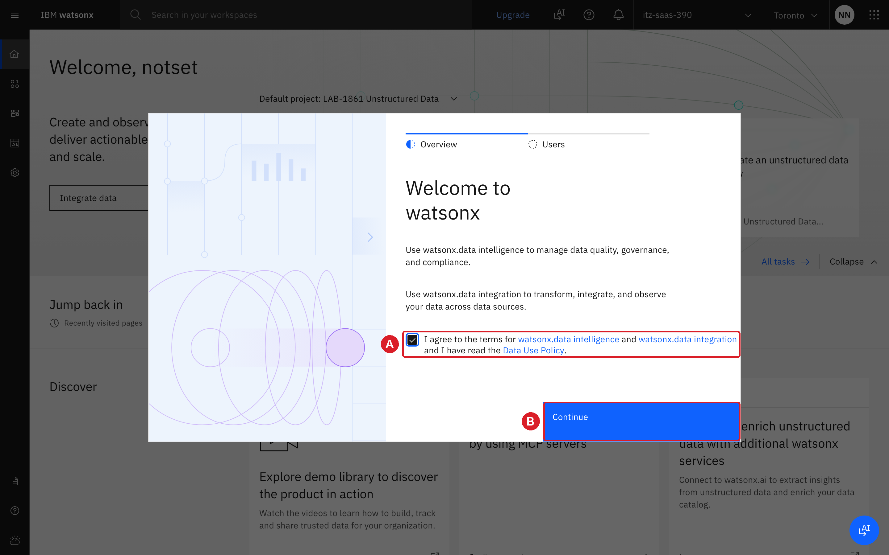
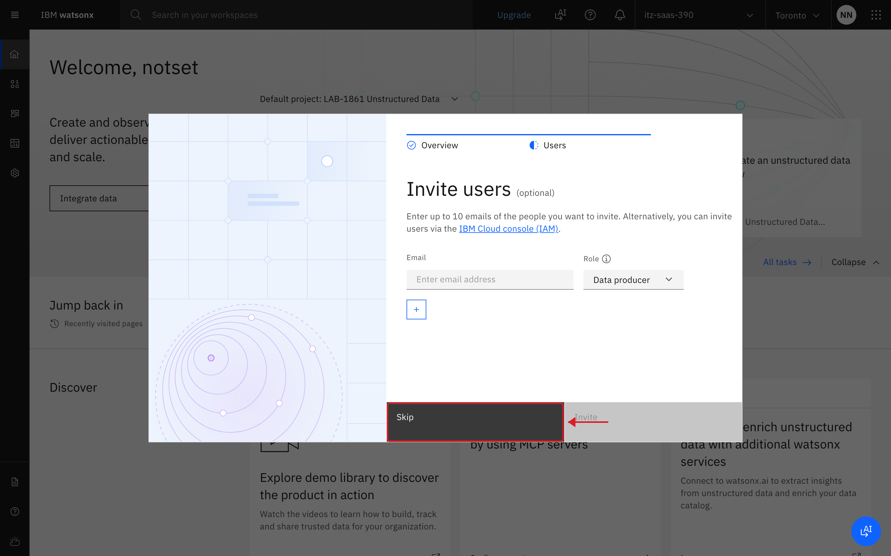

### 2.1 Sign in to watsonx.data integration

You sign in with the credentials of your environment, not with an IBMid.
Your instructor gives you a **seat number**. Find your seat in the following
table. It gives you the three values that you need: the **App ID** of your
environment, a **user name** and a **password**.

!!! note "Your sign-in details"
    | Seat | TechZone account | App ID (account alias) | User name | Password |
    |---|---|---|---|---|
    | 2 | `itz-saas-898` | `9a0657c181bd492eb69e597824c19f59/jC3SUUibQC` | `student0@6adb62123df8aede3c90cf0a.techzone.com` | `gN9ZXJmRegxjLfYi` |
    | 3 | `itz-saas-650` | `d81a405e26dd46b3b4c657b2faf66cdd/YASnnHB3bw` | `student0@6adb62123a6e56cbabb4016d.techzone.com` | `ia8YVibL5ncs7O2l` |
    | 4 | `itz-saas-227` | `3c13bce39d784d2485912140a5314358/bUkgaaKhTS` | `student0@6adb62140ce87dacbc0a3b58.techzone.com` | `bKCyPec76B7SZ59W` |
    | 5 | `itz-saas-492` | `18455fa51ad148d483876241abe5178f/ndaMBDpYsV` | `student0@6adb621672f22b596f36e955.techzone.com` | `of4DdIPf#wJNzRul` |
    | 6 | `itz-saas-621` | `66a3f0271aca43108b57850e54f6fd39/sJNwxsechb` | `student0@6adb6217f44a8fc4a7b3ec21.techzone.com` | `LZpY9idIWzu8KeBy` |
    | 7 | `itz-saas-299` | `a0b1276094224ac1bbebe4816c3b5720/NoXVD98PZZ` | `student0@6adba00e14fa6f7c36f4211d.techzone.com` | `q-LnDXn3PnZGCj3K` |
    | 8 | `itz-saas-332` | `e0992f9dc523456dae0cbac61a6a7f8e/n3VXOLP9uZ` | `student0@6adb6219d2a115262f723206.techzone.com` | `oomtDPknXswWdYtj` |
    | 9 | `itz-saas-158` | `be5a2122fd844a068bf0b2f194507763/aExfTpnTTY` | `student0@6adb621acfbde968bbd6c4fe.techzone.com` | `2GT6RQVjGYBQjXh#` |
    | 10 | `itz-saas-374` | `6fe7cdc9ef3741b5a4a42e7f1360c406/9BrXpeKR0j` | `student0@6adb621b0ce87dacbc0a3b59.techzone.com` | `u1HH!16WQERxsNW-` |
    | 11 | `itz-saas-160` | `1913f130cb8a4a5fa666aa2dc898c3cb/mg5Mp8r52r` | `student0@6adc205fd7e6d2b056e91089.techzone.com` | `5ywJOh94TnmpHlUf` |
    | 12 | `itz-saas-127` | `b371c883906d490f96d166fe74232e61/i1dKlaMzM7` | `student0@6adb621c9f864bdf678d6c1f.techzone.com` | `FICTj#aoxcU6hgqN` |
    | 13 | `itz-saas-519` | `c7d51bc85907466694e5dcf62118cf2b/zCeYYtOPo7` | `student0@6adb621c1f969c7bcd93c023.techzone.com` | `q4ef6yV426THoWEC` |
    | 14 | `itz-saas-220` | `4757af2e63954029966239118b2deab7/5Cr9dfvdCZ` | `student0@6adb621d756e2ee3839c5833.techzone.com` | `jo5QHiRN7ph582gk` |
    | 15 | `itz-saas-736` | `8fd3fc86497b47808735e8d67576b91a/ysnqHqDF8t` | `student0@6adba0108db8981ec7076436.techzone.com` | `4bo1kC!mQ4bpUQpP` |
    | 16 | `itz-saas-342` | `c505d9eebe254cab922ec088ae2f06f7/9dPIvpmlEG` | `student0@6adba011f44a8fc4a7b3ef24.techzone.com` | `NO-lM!IIsQoQZYbT` |
    | 18 | `itz-saas-681` | `d5c2541e5a8a47a0bed5756de5996779/I8sbQm6VJk` | `student0@6adb6223021fdaa1f4d6c855.techzone.com` | `OaDW9fwSCo!ki!y#` |
    | 19 | `itz-saas-148` | `085de509ec804ae78ae2d5794f08e35c/9vzf4WgGvZ` | `student0@6adb62247d2890b49f681871.techzone.com` | `utjFN9R6RBZdgSyO` |
    | 20 | `itz-saas-246` | `09c4021b8d4a46feb9ddab839c39f106/B4Kzwo0TsG` | `student0@6adbb5bdbe3bdd9d53b1c011.techzone.com` | `S0vl-MwXnKZE3v!!` |
    | 21 | `itz-saas-935` | `fd7d4018959843279e00937c4edfabc2/jVkDu0V6Kh` | `student0@6adbb5be45db757cf9692591.techzone.com` | `b#NuanYmMV3S7Ddu` |
    | 22 | `itz-saas-683` | `c082f5f691434228ad81ee3865a9ea8f/E7tnOB0IZW` | `student0@6adbb5c37fa9ac0aa6a4b539.techzone.com` | `9PgA5iBYi3lG3!Ny` |
    | 23 | `itz-saas-750` | `911b5a29b16e42cba60d4f6eb74f1f2c/7Nc9Q68TzG` | `student0@6adba0169a0f5d62dc7dad75.techzone.com` | `MrmH2FCe652V7Pq7` |
    | 24 | `itz-saas-261` | `df8c82c795aa47e8bc4b3e8f372e4eb2/D6C3S4Ol1S` | `student0@6adb622b335d8bf8389b7c0f.techzone.com` | `DSpXLiP1WyXYpppD` |
    | 25 | `itz-saas-377` | `3aaf04d6872247088a07c40ba1f10186/ApfgBD10Y4` | `student0@6adb622abe3bdd9d53b1bc53.techzone.com` | `vjt7IF-FlK9lC#9j` |
    | 26 | `itz-saas-656` | `a85a4309175f4f02b540217b49a7886f/lqsjiYDI71` | `student0@6adba015b2fcdcc9f0745b25.techzone.com` | `P74l8ThcBeJSHwGy` |
    | 27 | `itz-saas-729` | `0b12758e8f3d4e78a67ff0c2cd10910d/dA8cU8wvh6` | `student0@6adb622df44a8fc4a7b3ec22.techzone.com` | `2JOVDJ8Ph3V#P5Pt` |
    | 28 | `itz-saas-566` | `df68e6c64afc400887fccd75e6af2a1f/6RwqTWC2a6` | `student0@6adb622ee2a7614776c83fbd.techzone.com` | `OyLB-B0hUVmMZ#R!` |
    | 29 | `itz-saas-230` | `652b9988dda74569b72459789ee069ff/WQpVJtNCrs` | `student0@6adb62313df8aede3c90cf0d.techzone.com` | `OW8Wa5cCI2QdJ29D` |
    | 30 | `itz-saas-597` | `db6b0101ea084e8f83633e8f4b0518a3/wPOcriTstF` | `student0@6adba01545db757cf96924f7.techzone.com` | `55ekJWaHBEZKZ4XW` |
    | 33 | `itz-saas-933` | `f269966e668049699bee4ee493508062/ojsPAAvtFQ` | `student0@6adbb5c374a8d89e75b71124.techzone.com` | `IMdCzT#2-4Z!-ZHe` |
    | 34 | `itz-saas-390` | `0c41b6d6a1a4475fbd91ae67d7cd9593/UBN7AqPMNO` | `student0@6adba01a836b50a6c374fd9b.techzone.com` | `QjuSJzQRVn6TA43R` |

1. In the table, find the row of your seat. Keep the row visible: you copy
   from it in steps 4 and 5.

2. Copy the link <https://ca-tor.dai.cloud.ibm.com/df/home?context=df>
   (right-click it and select **Copy link address**), and paste it into a new
   tab of the browser on your main screen.
   The page **Log in to IBM watsonx** opens.

3. Under **Work with resources in this IBM Cloud region**, select **Toronto
   (ca-tor)** (A). Under **Log in with**, select **IBM Cloud IdP / AppID** (B).

    { .screenshot }

4. In **Account alias**, paste the **App ID** of your seat from the table (A).
   Click **Log in** (B).

    { .screenshot }

    The field might show the message *Alias must have 3-25 alphanumeric
    characters*. Ignore the message. The login accepts the full identifier.

    { .screenshot }

5. The sign-in page of your environment opens. Copy the **User name** and the
   **Password** of your seat from the table.

6. On the sign-in page, paste the user name into **Username** (A) and the
   password into **Password** (B). Click **Sign in** (C).

    { .screenshot }

    The first time you sign in, the page **Provide your information to
    continue** can open. Click **Continue**.

7. The first time you sign in, a **Welcome to watsonx** window opens. Select
   the check box that accepts the terms (A), and then click **Continue** (B).

    { .screenshot }

8. The window shows **Invite users**. Click **Skip**.

    { .screenshot }

    If a short tour starts on the home page, close it with the **X**.

**Check your progress:** the IBM watsonx home page opens. The top bar shows
your TechZone account, whose name starts with `itz-saas-` (A), and the region
**Toronto** (B). Keep this tab open. You use it for the rest of the lab.

{ .screenshot }
