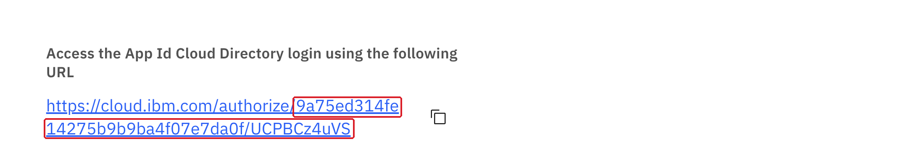
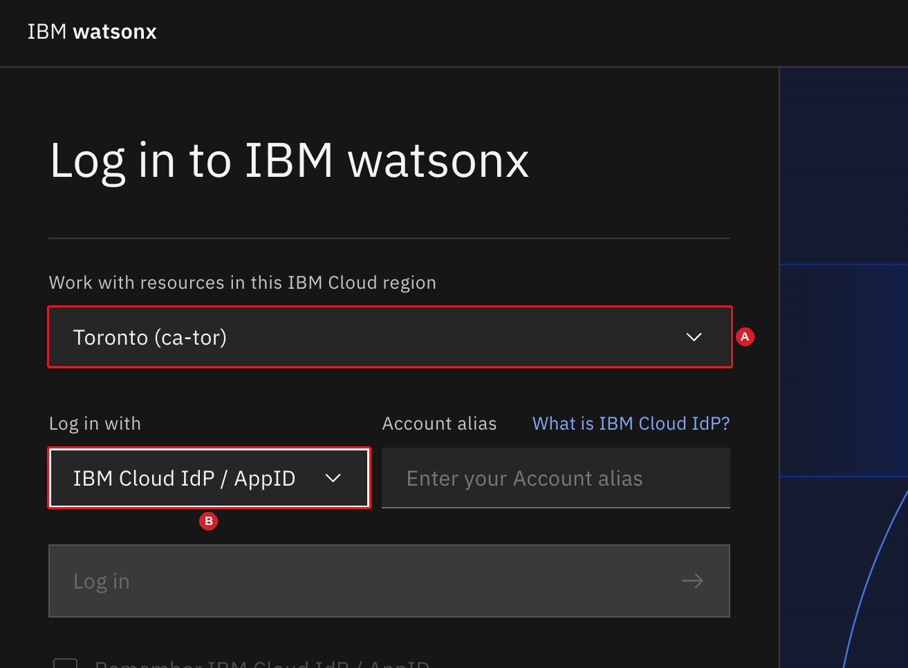
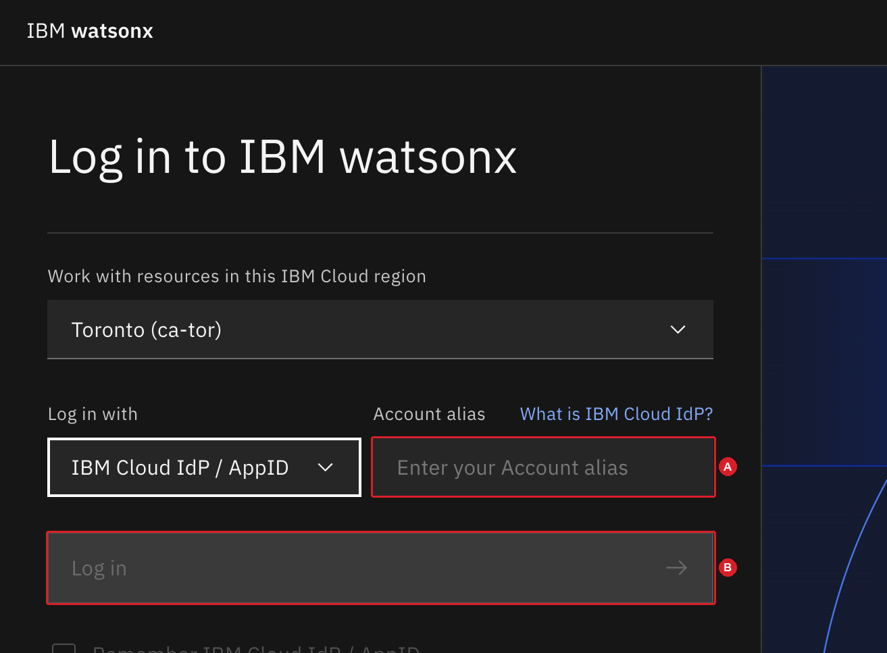
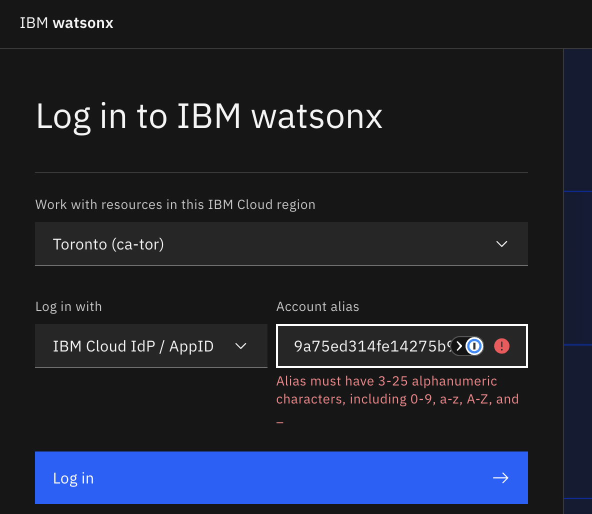
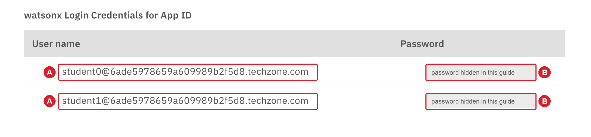
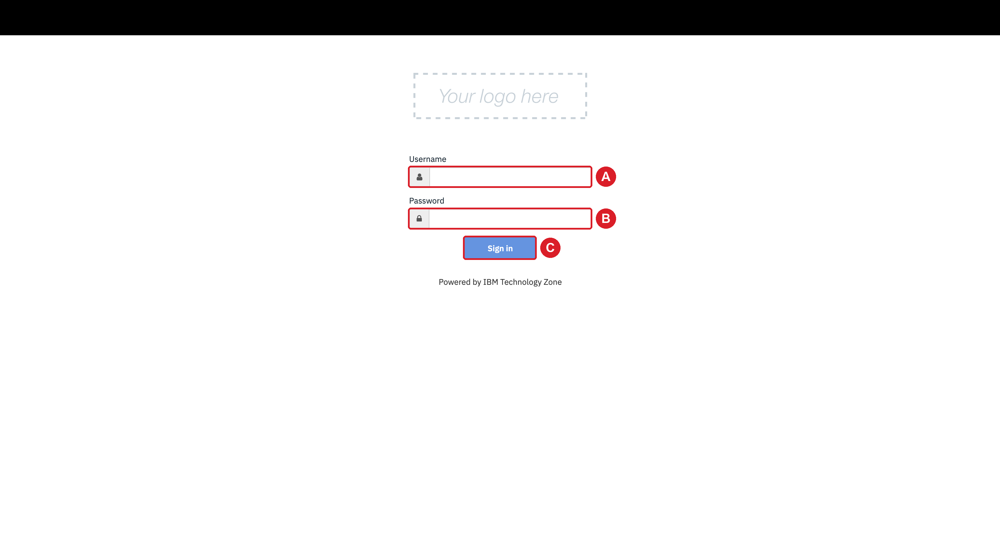
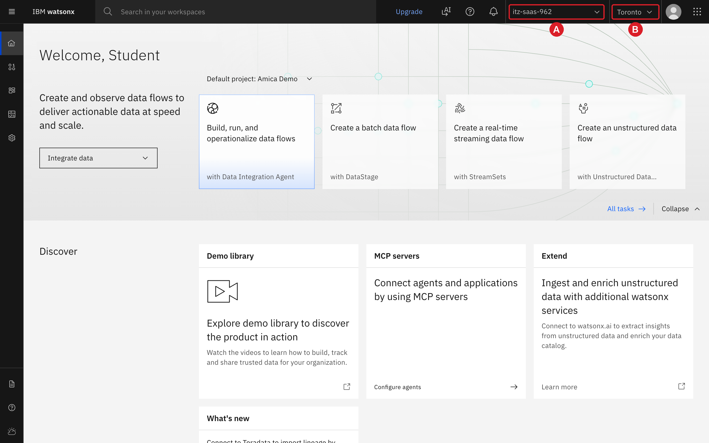

### 2.1 Sign in to watsonx.data integration

You sign in with the credentials of your TechZone environment, not with an
IBMid. The reservation page of your environment provides two things that you
need: the identifier of your environment and the user names and passwords.

1. On your TechZone reservation page, find the heading **Access the App Id
   Cloud Directory login using the following URL**. Copy the identifier at
   the end of that URL: everything after `authorize/`, including the part
   after the slash.

    { .screenshot }

2. Copy the link <https://ca-tor.dai.cloud.ibm.com/df/home?context=df>
   (right-click it and select **Copy link address**), and paste it into a new
   tab of the browser on your main screen.
   The page **Log in to IBM watsonx** opens.

3. Under **Work with resources in this IBM Cloud region**, select **Toronto
   (ca-tor)** (A). Under **Log in with**, select **IBM Cloud IdP / AppID** (B).

    { .screenshot }

4. In **Account alias**, paste the identifier that you copied in step 1 (A).
   Click **Log in** (B).

    { .screenshot }

    The field might show the message *Alias must have 3-25 alphanumeric
    characters*. Ignore the message. The login accepts the full identifier.

    { .screenshot }

5. The sign-in page of your environment opens. Return to your TechZone
   reservation page and find the table **watsonx Login Credentials for App
   ID**. The table lists two users, `student0@...techzone.com` and
   `student1@...techzone.com`. Choose one of them and use it for the whole
   lab. Copy its **User name** (A) and its **Password** (B).

    { .screenshot }

6. On the sign-in page, paste the user name into **Username** (A) and the
   password into **Password** (B). Click **Sign in** (C).

    { .screenshot }

    The first time you sign in, the page **Provide your information to
    continue** can open. Click **Continue**.

**Check your progress:** the IBM watsonx home page opens. The top bar shows
your TechZone account, whose name starts with `itz-saas-` (A), and the region
**Toronto** (B). Keep this tab open. You use it for the rest of the lab.

{ .screenshot }
