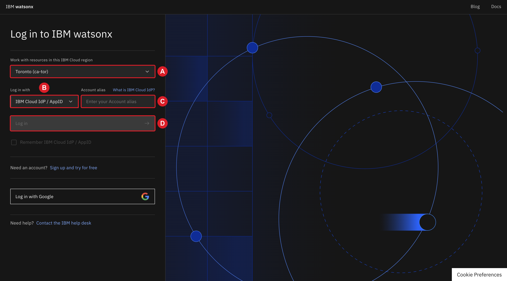

### 2.1 Sign in to watsonx.data integration

You sign in to watsonx.data integration with the credentials of your TechZone
environment, not with an IBMid. The reservation page of your environment
provides them.

1. On your TechZone reservation page, locate **Access the App Id Cloud
   Directory login using the following URL**. The link contains the Cloud
   Directory ID of your environment: everything that follows `authorize/`,
   including the part after the slash. Copy that whole identifier.

    { .screenshot }

2. Open <https://ca-tor.dai.cloud.ibm.com/df/home?context=df> in a new tab.
   The **Log in to IBM watsonx** page opens.

3. Under **Work with resources in this IBM Cloud region**, select **Toronto
   (ca-tor)** (A). Under **Log in with**, select **IBM Cloud IdP / AppID**
   (B). In **Account alias**, paste the Cloud Directory ID (C). Click **Log
   in** (D).

    { .screenshot }

    The field can display the message *Alias must have 3-25 alphanumeric
    characters*. Ignore it: the login works with the full ID.

    { .screenshot }

4. The sign-in page of your environment opens, with the fields **Username**
   and **Password**. The credentials are on your TechZone reservation page,
   in the table **watsonx Login Credentials for App ID**. The table lists two
   users, `student0@...techzone.com` and `student1@...techzone.com`. Either
   one works; pick one and keep using it. Copy its full **User name** (A)
   and its **Password** (B).

    { .screenshot }

5. On the sign-in page, paste the user name in **Username** (A) and the
   password in **Password** (B). Click **Sign in** (C).

    { .screenshot }

**Check your progress:** the IBM watsonx home page opens. The top bar shows
your TechZone account, whose name starts with `itz-saas-`, and the **Toronto**
region. Keep this tab open: the rest of the lab uses it.
