# Lab: Data observability across streaming, DataStage and Airflow

<!-- LAB-3079 -->

**Duration:** about 90 minutes

**Products:** watsonx.data integration (Data Observability, StreamSets Data
Collector, DataStage), Apache Airflow, IBM Bob

**What you need:** a TechZone reservation of the watsonx.data integration
environment. Its reservation page provides your sign-in credentials. The lab
environment is prepared for you before the session.

## 1 Introduction

A pipeline that fails without notice causes more damage than one that fails
with a visible error. When a nightly job stops and no one is notified, the
next morning's finance reports and dashboards present stale data as current.
Data teams often learn about a failed pipeline from the data consumers, hours
or days later. Most of the remediation time is then spent locating the
failure and its cause.

**Data Observability** in watsonx.data integration gives you a unified view
of jobs and outcomes across your projects. It shows which jobs are observed,
raises an alert when a job fails or when a metric leaves its expected range,
and forwards each alert to the applications that your team already uses. For
DataStage jobs, it detects issues in job runs with AI and reports the probable
root cause. It observes jobs that run on the platform and pipelines that run
outside it, such as Apache Airflow pipelines.

> **Explainer - Alerts, metrics and coverage**
> An **alert definition** is a rule that applies to one or more jobs: for
> example, "the run state of this job is Failed", or "the metric
> `rows_loaded` of this job deviates from 1,000 by more than 40%". A
> **triggered alert** is one occurrence of that rule. **Observability
> coverage** is the percentage of your jobs that have at least one alert
> definition or metric chart.

### 1.1 Use case overview

**Summit Outfitters** is an online retailer of outdoor equipment. In this lab,
you are the Summit data engineer. You own three pipelines, and each one
breaks during the lab:

1. **Finance, live:** the **Order feed** is a StreamSets job. It copies each
   storefront order from Kafka into a PostgreSQL table that the finance team
   uses. Today the web team releases a website update that changes how the
   storefront formats an order. Nobody tells the data team. The job continues
   to run, but the finance table rejects every new order.
2. **Finance, nightly:** the DataStage job **Supplier spend - nightly** totals
   supplier invoices for the finance team. The invoicing team renamed a column
   last night, and the job now fails.
3. **Marketplace:** Summit also sells through the TrailMart marketplace. The
   Apache Airflow pipeline **marketplace_settlements_daily** loads TrailMart's
   daily sales every night, on a server outside the platform. Last night
   TrailMart changed its API. The pipeline finished successfully and loaded
   only part of the day, so every task in Airflow is green.

The lab builds up in three steps. You start with **metrics and alerts** on the
order feed, and the alerts reach your team's on-call channel. You then let
**AI issue detection** find the root cause of the DataStage failure. Finally,
you extend observability to a pipeline **outside the platform**, and an AI
agent, **IBM Bob**, uses Data Observability's data to find the cause and
repair the pipeline.

## 2 Getting started

In the screenshots, a red box and arrow mark the element to click. When a
screen requires several actions, the letters **A**, **B** and **C** show the
order.

!!! warning "Keep every tab open"
    You work in three browser tabs: **watsonx.data integration** (your
    project and Data Observability), the **on-call channel** and **Airflow**.
    Open each one once and switch between them.

--8<-- "labs/_signin.md"

### 2.2 Create your task credentials

Jobs that you run in watsonx.data integration run with your **task
credentials**, an API key that the platform creates and stores for you. You
create them once.

1. In the watsonx tab from section 2.1, open
   <https://ca-tor.dai.cloud.ibm.com/settings/profile?context=df>. Confirm
   that the top bar shows your TechZone account, whose name starts
   with `itz-saas-` (A), and the **Toronto** region (B). If they differ,
   select **Toronto** first, and then your `itz-saas-` account.

    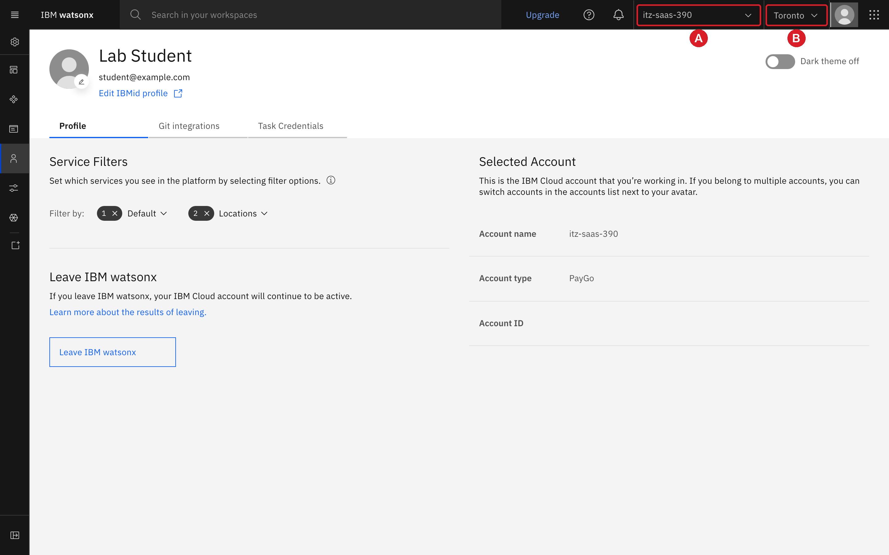{ .screenshot }

2. Click the **Task Credentials** tab (A), and then click **Create task
   credential** (B).

    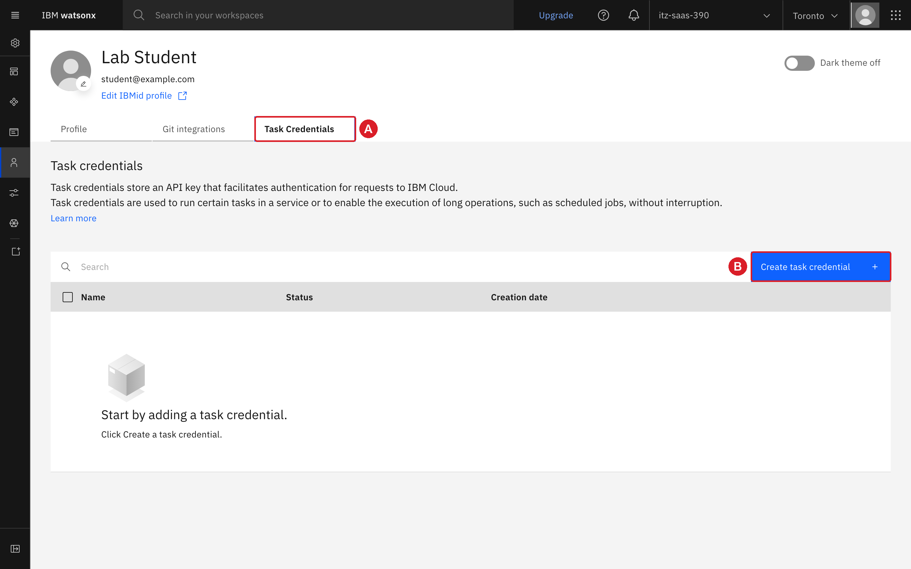{ .screenshot }

3. In **Name**, type `lab` (A), and then click **Create** (B).

    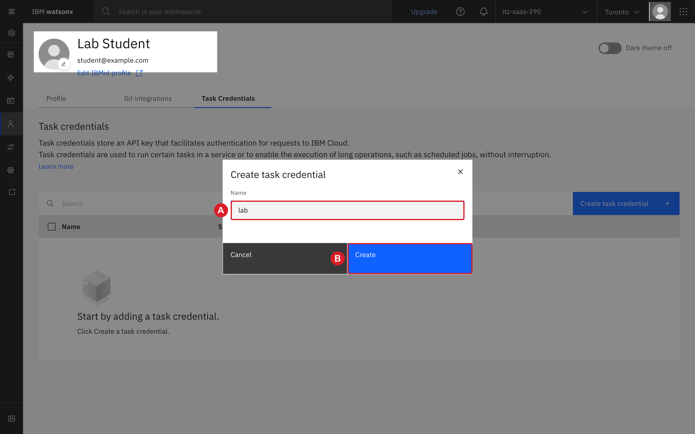{ .screenshot }

**Check your progress:** the table lists the task credential **lab**.

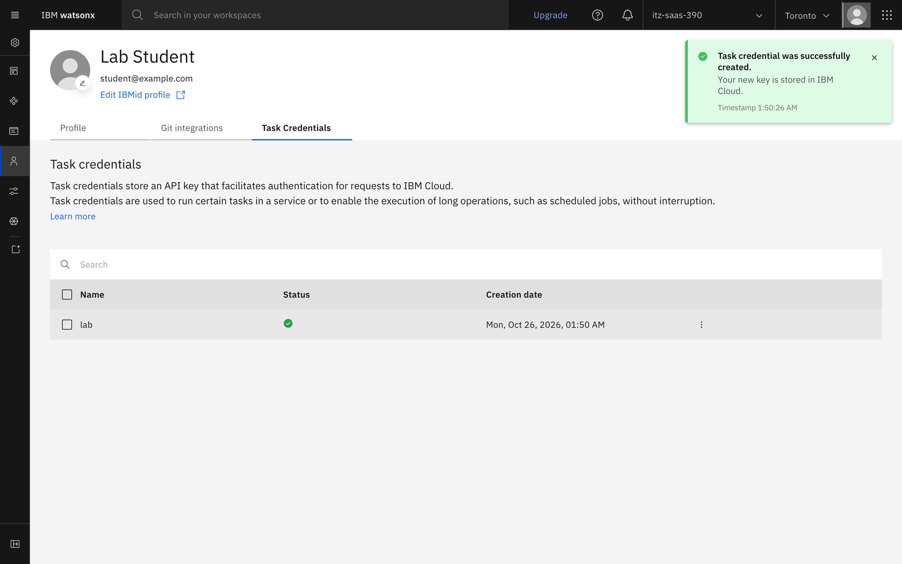{ .screenshot }

### 2.3 Open Data Observability

1. Click the **☰** menu at the upper left (A). Click **Operations** (B), and
   then click **Data observability** (C).

    { .screenshot }

2. If a welcome dialog opens, click **Continue**. The dialog opens only the
   first time.

    { .screenshot }

3. The **Dashboard** opens. It aggregates the state of your jobs:
   **Observability coverage** (A), the percentage of your jobs that are
   observed; **Triggered alerts** and **Open alerts** (B), the alerts that
   were raised and the ones that are not yet resolved; and **Issue detection
   powered by AI** (C), the issues that AI detected in your job runs. From
   here you create and manage alerts, configure alert receivers, and add
   metric charts.

    { .screenshot }

**Check your progress:** coverage shows **0%**, because none of your jobs has
an alert definition yet.

### 2.4 Open your team's on-call channel

You can be notified about alerts directly by assigning **alert receivers** to
them. Alert receivers are external applications, such as email, Slack,
Microsoft Teams, PagerDuty or a custom webhook, to which Data Observability
forwards alerts. They inform your team about critical issues as they occur,
so that the team can solve them without watching a dashboard.

In this lab, the Summit data team's **on-call channel** is the receiver. The
lab setup already created it in Data Observability as a custom webhook named
**Lab - alert viewer**, connected to the channel of your TechZone account.

1. Open <https://alert-webhook.23ij0n2ztu5p.ca-tor.codeengine.appdomain.cloud/>
   in a new tab.

2. In the account box, type your TechZone account name, for example
   `itz-saas-351` (A). It is shown in the top bar of Data Observability.
   Click **Open my channel** (B).

    { .screenshot }

3. Your channel opens. It shows **Listening** and no alerts yet. Keep this
   tab open: every alert that you assign to **Lab - alert viewer** appears
   here within about a minute of being triggered.

    { .screenshot }

4. Return to the Data Observability tab and click the **Alert receivers**
   tab.

**Check your progress:** **Lab - alert viewer** is listed with the status
**Connected**. Use this receiver in the lab; do not create another one.

{ .screenshot }

## 3 Streaming: detect a feed that runs but loads nothing

A streaming problem that produces no failure is the most difficult to detect.
A job that stops with an error shows the state **Failed**. A job that receives
data it cannot load remains in the **Running** state: it reads every record,
sends each one to error handling, and writes nothing to its target. A
monitoring tool that checks only job state reports that the job is healthy.

**Order feed - live** is a StreamSets job that runs on the Data Collector
engine. It reads each storefront order from the Kafka topic `shop.orders`,
passes it through the **Order amounts** stage, and writes it to the PostgreSQL
table `shop.orders_feed`, which the finance team uses. In this section, a
website update changes the format of the order total. You detect the problem
with a **metric** alert, which evaluates the number of records that the job
rejects instead of its state.

> **Explainer - How the feed reaches Data Observability**
> The StreamSets engine reports the metrics of each running job to Data
> Observability every minute, for example the number of records that the job
> reads, writes and sends to error handling. In Data Observability, the job is
> listed under its job name followed by its job ID, for example **Job for
> Order feed - live-01a174b4-...**. A metric alert compares the most recent
> value of a metric with the condition that you define.

### 3.1 Create a metric alert for the feed

1. In Data Observability, click **New alert**.

    { .screenshot }

2. Click **Metric** (A), and then click **Next** (B).

    { .screenshot }

3. Click **Find a workspace** and select your project. Its name starts with
   `wxdi-auto-demo-`.

    { .screenshot }

4. Under **Asset**, click **Select asset**.

    { .screenshot }

5. Click the job whose name starts with **Job for Order feed - live** (A). The
   metrics of the job are displayed with their most recent values. Select
   **pipeline.batchErrorRecords.meter.m1_rate** (B). This metric is the number
   of records per second that the job sent to error handling over the last
   minute, currently 0. Click **Add assets** (C).

    { .screenshot }

6. Click **Next**.

7. Click **Fixed value** (A). In the **Operator** list, select **Greater than
   >** (B). In the box to the right, which is labelled with the metric name,
   replace the value with `0.01` (C). With this condition, the alert is
   triggered as soon as the feed rejects records. Click **Next** (D).

    { .screenshot }

8. Turn on **Suppress repeated alerts** (A). With this setting, a feed that
   continues to reject records sends one alert instead of one alert every
   minute. Click **Critical** (B). In **Name**, type
   `Lab - Order feed rejecting orders` (C). You can ignore the message that
   recommends a name of 32 characters or fewer. Click **Next** (D).

    { .screenshot }

9. Expand **Custom webhook** (A), select **Lab - alert viewer** (B), and then
   click **Create** (C).

    { .screenshot }

**Check your progress:** the **Defined alerts** tab lists **Lab - Order feed
rejecting orders** with **1 alert receiver**.

### 3.2 Release the website update

The web team releases its website update. In this lab, a DataStage job named
**Simulate a storefront website update** plays the part of that release: an
after-job script pushes the change to the storefront, and from then on the
storefront formats the order total as `"84.10 USD"` instead of `84.10`.

1. Click the **☰** menu (A), click **Projects** (B), and then click **All
   projects** (C).

    { .screenshot }

2. Click your project, **wxdi-auto-demo-** followed by eight characters.

    { .screenshot }

3. Click the **Assets** tab (A). Under **Asset types**, click **Flows** (B),
   and then click **Simulate a storefront website update** (C).

    { .screenshot }

4. The flow opens on the canvas. Click the **Settings** icon in the toolbar.
   In the settings, click **Before/after-job subroutines** (A). The
   **After-job subroutine** runs a shell command when the job finishes (B): it
   writes the release marker that switches the storefront to the new order
   format. Click **Cancel** to close the settings.

    { .screenshot }

5. In the toolbar, click **Run**. After about 20 seconds, the banner shows
   **Run successful**: the website update is live.

    { .screenshot }

**Check your progress:** the run succeeded. Nothing on the order feed has
changed: its job still shows **Running**.

### 3.3 Review the alert

1. Wait 2 to 3 minutes. Switch to the on-call channel tab. The alert **Lab -
   Order feed rejecting orders** is displayed with its severity, the job and
   the trigger value: the rate of rejected records, for example **0.06
   pipeline.batchErrorRecords.meter.m1_rate (threshold >0.01)**. Your team is
   notified without anyone opening the platform.

    { .screenshot }

2. Switch to the Data Observability tab and click **Triggered alerts** (A).
   Click **Lab - Order feed rejecting orders** (B).

    { .screenshot }

3. The alert details open. Click **Acknowledge** (A), so that your team sees
   that the alert is being handled. Then click **See all log** (B) to open the
   job run that triggered the alert.

    { .screenshot }

4. The job run page opens in a new tab. **About this run** shows that the job
   is still **Running** (A). The **Real time summary** shows the input,
   output and error records counts: the error records count increases (B).

    { .screenshot }

5. Under **Associated flow**, click **Order feed - live**. The flow opens on
   its canvas with the job running (A). The **Real time summary** shows the
   error records (B), and the **Logs** panel lists an **ERROR** for each
   rejected order (C). Read one of them: *Can't coerce '84.10 USD' of type
   'STRING' to column 'order_total'*. The order total now arrives as text
   with a currency, and the PostgreSQL column `order_total` accepts only
   numbers.

    { .screenshot }

**Check your progress:** the job state is still **Running**. Only the metric
alert detected that the finance table no longer receives orders, and the error
records show why.

### 3.4 Fix the feed

The website keeps sending the new format, so the feed must accept it. The
**Order amounts** stage prepares the order total before it is loaded. You
change it to remove the currency.

1. In the **Order feed - live** flow, click **Stop**. After a few seconds, the
   top bar shows **Job stopped**.

    { .screenshot }

2. Click the **Order amounts** stage (A). The stage settings open. Under
   **Expressions**, **Field expressions** lists the output field
   `/order_total` with the expression `${record:value('/order_total')}`.
   Click the **edit** icon next to it (B).

    { .screenshot }

3. In the **Field expressions** window, select the whole **Field expression**
   (A) and replace it with the following expression. Click **OK** (B).

    ```
    ${str:replace(record:value('/order_total'), ' USD', '')}
    ```

    { .screenshot }

4. Click **Save** (A), and then click **Run** (B).

    { .screenshot }

5. In **Select offset**, keep **Continue from last-saved offset** selected and
   click **Start run**. The feed resumes from the last order that it loaded.

    { .screenshot }

**Check your progress:** the top bar shows **Job Running**. In the **Real time
summary**, the output count equals the input count and the error records
count does not increase. The orders that arrived while the feed was stopped
are loaded too.

{ .screenshot }

### 3.5 Close the alert

1. Wait 2 minutes after the restart, so that the error records metric returns
   to 0.

2. In Data Observability, click **Triggered alerts**, click **Lab - Order
   feed rejecting orders**, and then click **Mark Resolved**.

    { .screenshot }

**Check your progress:** the alert moves to **Resolved alerts**, and the
**Open alerts** count on the dashboard returns to 0.

Consider what this incident costs without the alert. From the moment of the
website update, every order is rejected by the finance table while the job
reports **Running**. The revenue dashboard that the finance team refreshes
during the day stops increasing, and the daily revenue figure, the
reconciliation with the payment provider and the campaign performance report
are all computed from a table that is missing a day of orders. The first
person to notice is usually a finance analyst, the next morning, and the
investigation starts from the report, not from the job. With the metric alert,
the on-call engineer learns about the rejected orders within minutes, and the
feed is repaired before the first report is produced.

## 4 DataStage: detect and fix a failed nightly job

The finance team reviews the supplier spend summary every morning. The
DataStage job **Supplier spend - nightly** reads the invoices of the previous
night from the table `dobs_lab.supplier_invoices` in PostgreSQL, totals the
amount per supplier and category in the **Spend_KPIs** stage, and writes the
result to `dobs_lab.supplier_spend_summary`, the table behind the summary. In
this section, you configure an alert on the job state, the job fails because
the invoicing team renamed a column, and you use AI issue detection to
identify the cause.

### 4.1 Create an alert for the nightly job

1. In Data Observability, click **New alert**.

    { .screenshot }

2. Click **Job run state** (A), and then click **Next** (B).

    { .screenshot }

3. Under **Asset**, click **Select assets**.

    { .screenshot }

4. Under **Workspaces**, click your project.

    { .screenshot }

5. Select **Supplier spend - nightly.DataStage job** (A), and then click
   **Add assets** (B).

    { .screenshot }

    > **Explainer - Why the job is already listed**
    > The list shows only jobs that have run at least once. The lab setup ran
    > the nightly job once, before the invoicing team's change, and that run
    > succeeded. The job is therefore listed.

6. Keep **Operator** set to **Equal to =** and **State** set to **Failed**
   (A). Click **Next** (B).

    { .screenshot }

7. Under **Severity**, click **Critical** (A). In **Name**, type
   `Lab - Supplier spend failed` (B). Leave **Suppress repeated alerts**
   turned off. Click **Next** (C).

    { .screenshot }

8. Expand **Custom webhook** (A), select **Lab - alert viewer** (B), and then
   click **Create** (C).

    { .screenshot }

**Check your progress:** the **Defined alerts** tab lists **Lab - Supplier
spend failed** and **Lab - Order feed rejecting orders**, each with **1 alert
receiver**. Click the **Dashboard** tab: **Observability coverage** is now
greater than 0%, because a DataStage job is observed.

{ .screenshot }

### 4.2 Run the nightly job

In this task, you run the job from its flow, as a data engineer does after a
change.

1. Click the **☰** menu, click **Projects**, and then click **All
   projects**. Click your project.

2. Click the **Assets** tab. Under **Asset types**, click **Flows**, and then
   click **Supplier spend - nightly**. The flow opens on the canvas: the
   **Supplier_invoices** source, the **Spend_KPIs** aggregation and the
   **Supplier_spend_table** target.

    { .screenshot }

3. In the toolbar, click **Run**. The lab setup already compiled the flow, so
   the run is sent directly to the remote engine.

    { .screenshot }

4. After about 30 seconds, a red banner shows **Run failed**. Click **View
   log**.

    { .screenshot }

5. Review the log. It contains hundreds of lines of engine output, including
   environment settings, startup messages and errors from several stages. The
   top of the log does not identify the cause of the failure.

    { .screenshot }

6. In the **Find** box of the log, type `does not exist` (A) and press
   **Enter**. The error *column "amount" does not exist* appears at the far
   right of a long line, inside the SQL of a connector. It is one of 11
   errors in this log.

    { .screenshot }

    Without observability, troubleshooting requires several manual steps.
    You must know that the job failed, open the correct flow and its log, and
    know which text to search for. The log does not state that the invoicing
    team renamed a column, or who is responsible for the fix. Click the **X**
    to close the log.

### 4.3 Review the alert

1. Switch to the on-call channel tab. Within about a minute of the failure,
   **Lab - Supplier spend failed** is displayed with the trigger value
   **Failed**.

    { .screenshot }

2. Switch to the Data Observability tab. Click **Triggered alerts** (A), and
   then click **Lab - Supplier spend failed** (B).

    { .screenshot }

3. The details show the job, the run and the **Detected issue** from AI.
   Click **Acknowledge**.

    { .screenshot }

### 4.4 Use AI to identify the cause

1. Click the **Dashboard** tab (A). Under **Issue detection powered by AI**,
   click the issue for **Supplier spend - nightly.DataStage job** that reports
   that the column **'amount'** is missing from the
   **'dobs_lab.supplier_invoices'** table (B). Because AI generates the
   description, the wording can vary between runs.

    { .screenshot }

2. Click **Start troubleshooting**.

    { .screenshot }

3. Wait about 20 seconds while AI analyzes the logs, the DataStage flow and
   its knowledge base. Read the **Probable root cause** section.

    { .screenshot }

**Check your progress:** the root cause identifies the missing **amount**
column in the SQL of the **Supplier_invoices** stage. This diagnosis is
correct, because the invoicing team renamed **amount** to **amount_usd**.

!!! note "Check the recommendation before you apply it"
    **Recommended actions** suggests the column `total_spend_usd`. That name
    is incorrect, because it is the alias that the query assigns to its own
    result. The correct column is **amount_usd**. AI identifies the cause
    quickly, but you must still verify the fix.

### 4.5 Fix the flow

1. Switch to the tab with the **Supplier spend - nightly** flow, and
   double-click the **Supplier_invoices** stage.

    { .screenshot }

2. Scroll to the **SQL** section. Locate the **Select statement** field (A),
   and click the **Maximize** icon at its upper right (B). The statement
   opens in the **Expression builder**.

    { .screenshot }

3. In the editor, the statement contains `sum(amount)` (A). Change it to
   `sum(amount_usd)`, and then click **Apply and return** (B).

    { .screenshot }

4. Click **Save** at the bottom of the stage panel, and then click the
   **Compile** icon in the toolbar.

    { .screenshot }

5. When **Compile successful** is displayed, click **Run flow**.

    { .screenshot }

**Check your progress:** after about 20 seconds, the flow shows **Run
successful**, and 8 rows are written to **Supplier_spend_table**, one for
each combination of supplier and category.

{ .screenshot }

### 4.6 Close the alert

1. In Data Observability, click **Triggered alerts**, click **Lab - Supplier
   spend failed**, and then click **Mark Resolved**.

    { .screenshot }

**Check your progress:** the alert moves to **Resolved alerts**, and the
**Open alerts** count on the dashboard returns to 0.

{ .screenshot }

## 5 Airflow: detect a pipeline that succeeds with too little data

Not every pipeline runs on watsonx.data integration. The Summit data team runs
**marketplace_settlements_daily** in its own Apache Airflow environment. Every
night it reads the previous day's sales from TrailMart's partner API, page by
page, and loads them into the table that the daily revenue report uses. On a
normal night it loads about 1,200 settlements. The pipeline reports each run
to Data Observability, with the number of rows that it loaded.

Last night TrailMart changed how its API pages through results. The pipeline
still reads the first page, finds no indication of another page, and finishes
successfully. A run that loads 100 settlements instead of 1,200 is green in
Airflow. In this section, you detect it with a metric alert on the deviation
from a baseline, and an AI agent identifies the cause and repairs the
pipeline.

### 5.1 Create a metric alert for the pipeline

A fixed threshold works for the error rate of the feed, which must stay at 0.
The number of settlements varies from night to night, so this alert compares
each run with a **baseline** instead: a normal night loads about 1,000
settlements or more, and a deviation of more than 40% from that baseline is
not a normal night.

1. In Data Observability, click **New alert**.

2. Click **Metric** (A), and then click **Next** (B).

3. Click **Find a workspace** and select your project.

4. Under **Asset**, click **Select asset**.

5. Click **marketplace_settlements_daily** (A). Select **rows_loaded** (B). Its
   most recent value is about 1,200: the number of settlements that the last
   nightly run loaded. Click **Add assets** (C).

    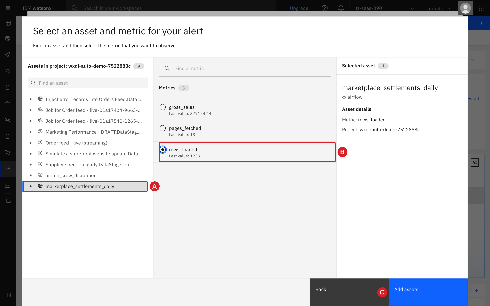{ .screenshot }

6. Click **Next**.

7. Click **Percent deviation** (A). In **Metric baseline value**, replace the
   value with `1000` (B). In the **Percent deviation** box, replace the value
   with `40` (C). The message below the fields states the resulting range,
   600 to 1,400 rows, and how many of the previous runs are outside it. Click
   **Next** (D).

    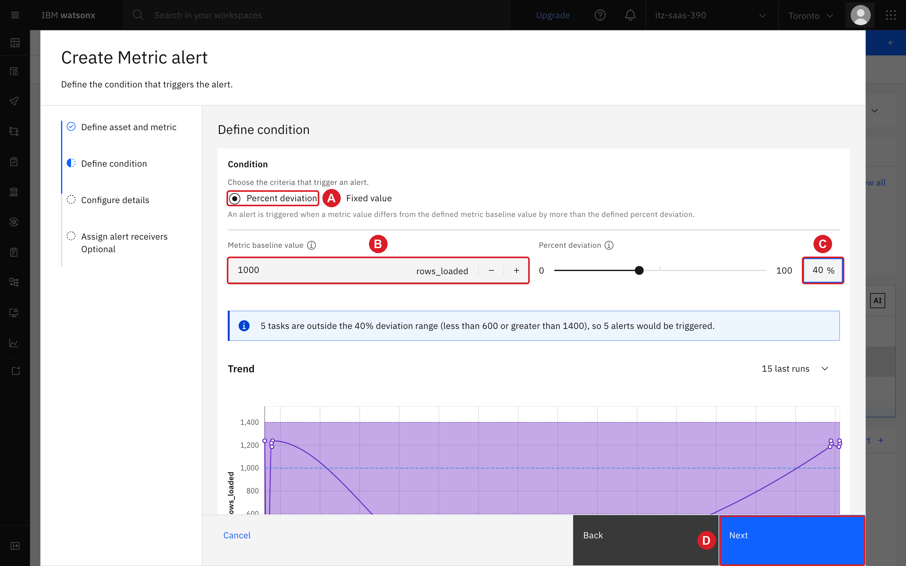{ .screenshot }

8. Click **Critical** (A). In **Name**, type
   `Lab - Marketplace settlements incomplete` (B). You can ignore the message
   about the name length. Click **Next** (C).

    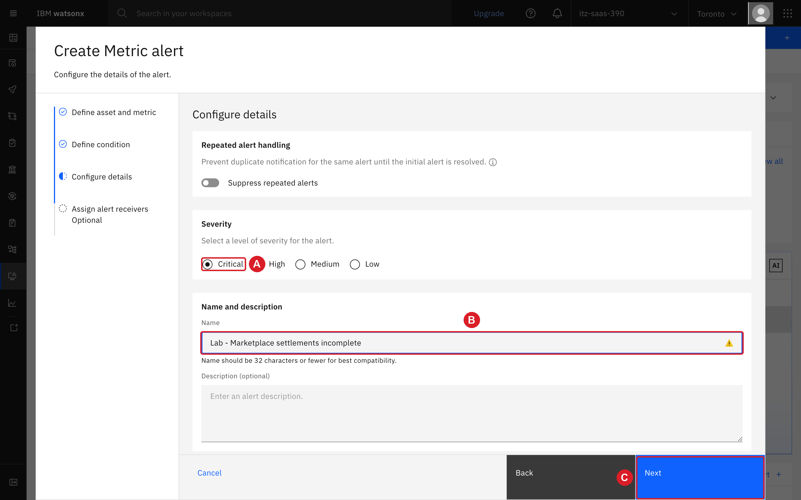{ .screenshot }

9. Expand **Custom webhook** (A), select **Lab - alert viewer** (B), and then
   click **Create** (C).

    { .screenshot }

**Check your progress:** the **Defined alerts** tab lists three lab alerts.

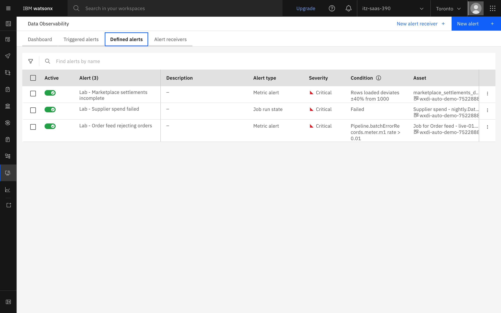{ .screenshot }

### 5.2 Open Airflow

Data Observability links each observed job to the system that runs it. You
open the Airflow environment from the alert that you just defined.

1. On the **Defined alerts** tab, click **Lab - Marketplace settlements
   incomplete**. The alert details open.

    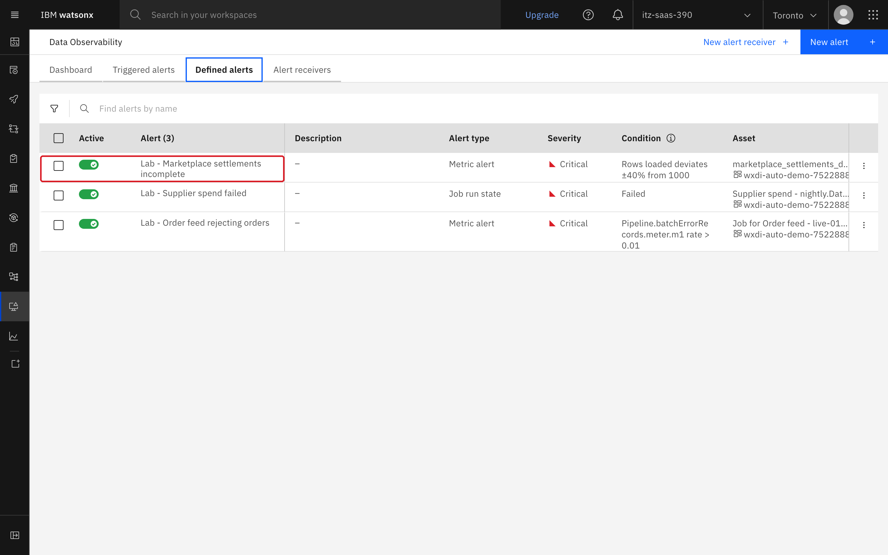{ .screenshot }

2. In the details, under **Asset details**, click the job name
   **Marketplace_settlements_daily**. Airflow opens in a new tab.

    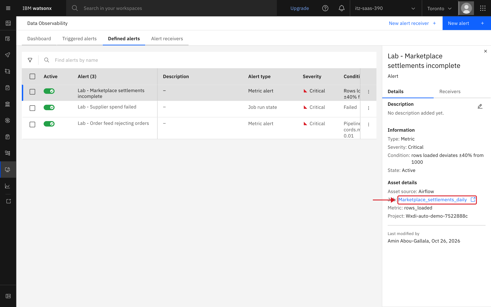{ .screenshot }

3. On the Airflow **Sign In** page, type `admin` in **Username** (A) and
   `IBMDem0s1` in **Password** (B). Click **Sign In** (C).

    { .screenshot }

4. Click **marketplace_settlements_daily**. The **Grid** view shows the runs
   for the previous nights. Every run is green: each night loaded more than
   1,100 settlements.

    { .screenshot }

**Check your progress:** every run in the grid is green. Do not change the
other DAGs in the list.

### 5.3 Run tonight's load

1. In Airflow, on the **marketplace_settlements_daily** page, click the
   **Trigger DAG** icon (a play button) at the upper right. A banner shows
   **Triggered marketplace_settlements_daily with new Run ID**.

    { .screenshot }

2. Wait about 30 seconds. The new run and all of its tasks are green.

    { .screenshot }

**Check your progress:** in Airflow, the run is successful. Nothing indicates
a problem.

### 5.4 Review the alert

1. Wait about 2 minutes. Switch to the on-call channel tab. The alert **Lab -
   Marketplace settlements incomplete** is displayed with the trigger value
   **100 rows_loaded**.

    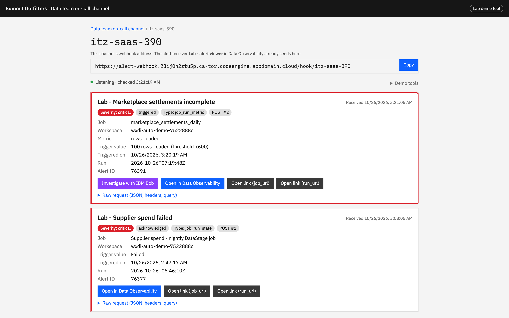{ .screenshot }

2. In Data Observability, click **Triggered alerts**, and then click **Lab -
   Marketplace settlements incomplete**. The trigger value reads **100 rows
   loaded (-90% from baseline)**: the run succeeded and loaded 100
   settlements, compared with about 1,200 on each of the previous nights.
   Click **Acknowledge**.

    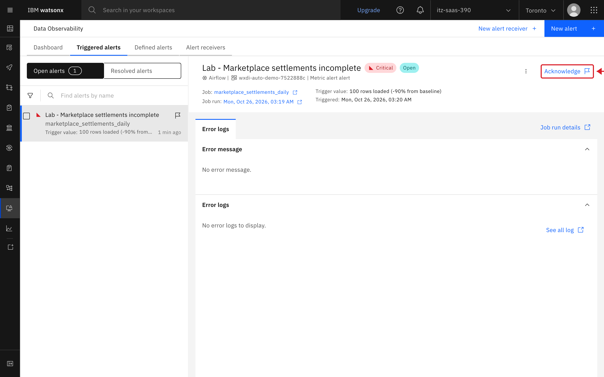{ .screenshot }

**Check your progress:** a successful run triggered an alert. An alert on job
state would not have detected this problem.

### 5.5 Hand the incident to an AI agent

Your team uses **IBM Bob**, run as a headless agent, to triage the incidents
that reach the on-call channel. Data Observability publishes its alerts, job
runs and metrics through an **MCP server**, so the agent reads the same
information that you reviewed: the alert, the run history of the pipeline and
the values of `rows_loaded`. With that information, it investigates the
cause and proposes a fix as a pull request for a person to review.

!!! note "A recorded session"
    In this lab, the agent's work is a replay of a recorded IBM Bob session,
    filled in with the values of your alert. It does not change your
    environment.

1. In the on-call channel tab, on the **Lab - Marketplace settlements
   incomplete** card, click **Investigate with IBM Bob**.

    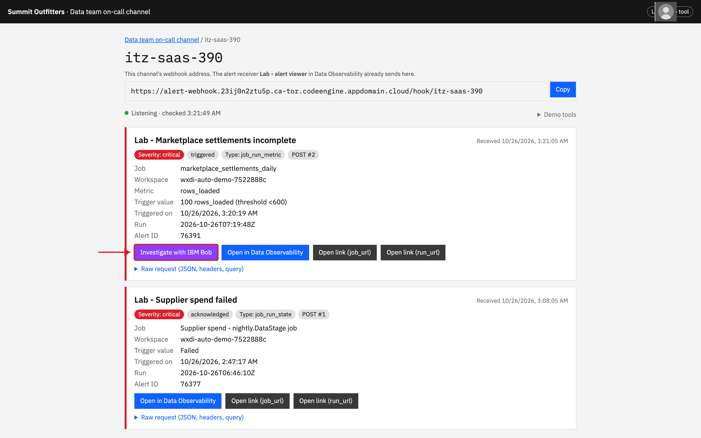{ .screenshot }

2. Follow the session as it runs. Through MCP, the agent reads the alert,
   compares `rows_loaded` with the previous runs, reads the task log, calls
   TrailMart's API, and identifies the cause: TrailMart now pages with a
   cursor, and the pipeline stops after the first page.

    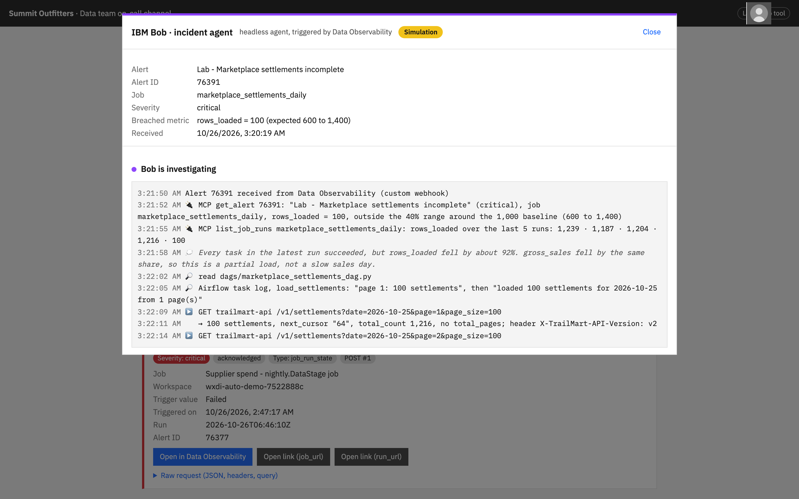{ .screenshot }

3. Review the pull request that the agent opened. The change follows TrailMart's
   cursor, and it fails the task when fewer rows arrive than TrailMart reports,
   so that a partial load can no longer finish successfully.

    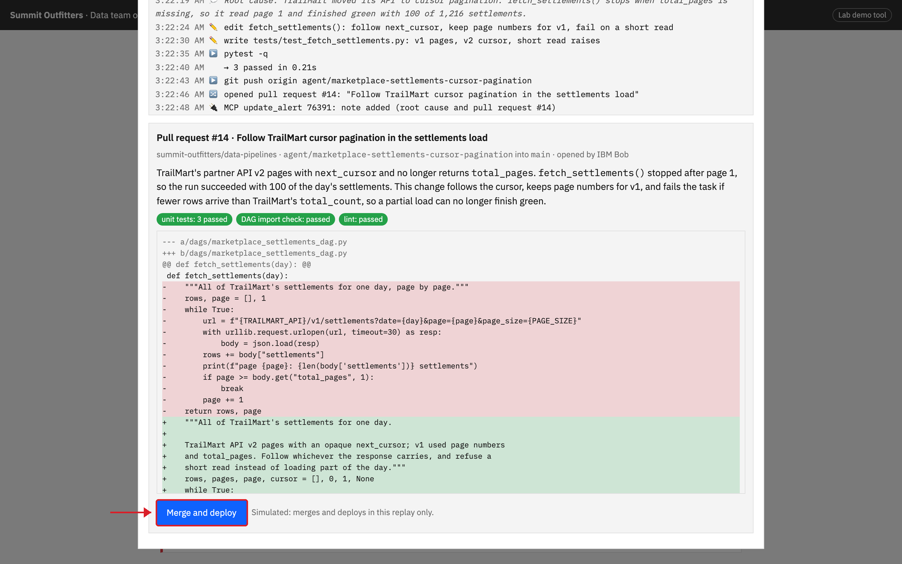{ .screenshot }

4. Click **Merge and deploy**. The session deploys the fix, runs the load
   again, and reports 1,216 settlements loaded.

    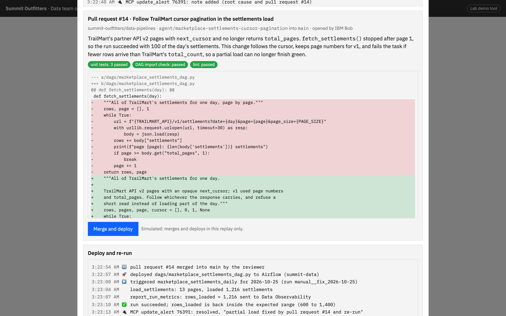{ .screenshot }

5. In Data Observability, open **Lab - Marketplace settlements incomplete**
   and click **Mark Resolved**.

**Check your progress:** on the **Dashboard**, **Open alerts** shows 0, and
**Observability coverage** has increased, because all three of your pipelines
are now observed.

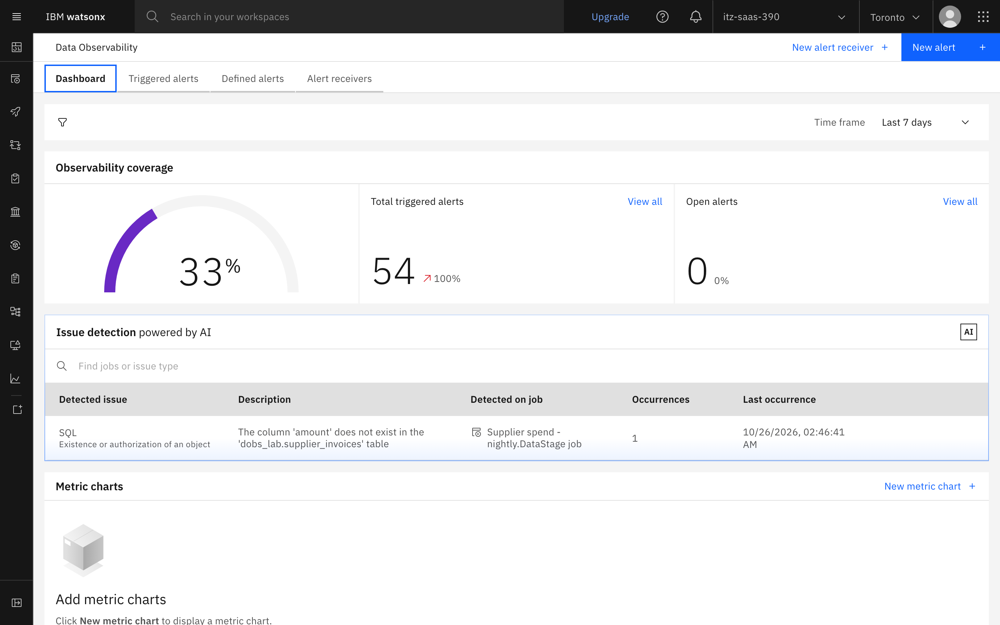{ .screenshot }

## 6 Summary

In this lab, you observed three different pipelines from one place, detected
three different problems, and resolved each one.

**Key Features & Benefits**

**Notification where the team works** – Every alert in this lab reached the
on-call channel within about a minute, with the job, the severity and the
value that triggered it, before any downstream user was affected. Alert
receivers deliver the same notification to email, Slack, Microsoft Teams,
PagerDuty or any webhook.

**Detection beyond job state** – Two of the three problems produced no
failure. The order feed continued to run while it rejected every order, and
the marketplace pipeline succeeded with a partial day. Metric alerts on the
records that a job rejects and on the deviation of the rows that a pipeline
loads detected both within minutes. An alert on job state alone would not have
detected either one.

**Faster root cause analysis** – For DataStage, AI issue detection analyzed
the logs and the flow and identified the renamed column. For the marketplace
pipeline, an AI agent used Data Observability's MCP server to read the alert
and the run history, found the API change, and proposed a tested fix.

**A single view across environments** – StreamSets, DataStage and an Apache
Airflow pipeline on a server outside the platform report to one place. They
share the same alert definitions, the same alert receivers and one coverage
figure.

## 7 Reference

- [watsonx.data integration documentation](https://dataplatform.cloud.ibm.com/docs/content/wsj/getting-started/welcome-main.html?context=df)
- [Data Observability documentation](https://dataplatform.cloud.ibm.com/docs/content/dstage/dsnav/topics/data-observability.html?context=df)
- [Apache Airflow documentation](https://airflow.apache.org/docs/)
