# LAB-3106: Remote Engines: Running watsonx.data Integration Anywhere

!!! abstract "Session abstract · LAB-3106 · Hands-on Lab · Data Management"
    Not every organization is ready to move everything to the cloud, and
    they shouldn't have to. In this session, learn how watsonx.data
    integration remote engines let you keep data processing in your own
    environment, whether that's on-premises, AWS, Azure, or any other
    infrastructure you manage, while still taking advantage of a
    cloud-managed control plane.

    We'll cover how remote engines are deployed, how they connect to the IBM
    network, and how the two-tier architecture gives you the flexibility to
    meet your organization's security and data residency requirements
    without sacrificing the benefits of a modern platform.

    *Wednesday, October 28, 2026, 12:45 PM – 2:15 PM · Lab 06, Labs & Certifications, Sandbox*

**Process e-commerce data where it resides, and turn the results into business decisions.**

**Duration:** about 60 minutes, plus an optional appendix

**Products:** watsonx.data integration (remote batch engine, streaming engine
built on Apache Flink), Apache Kafka

## 1 Introduction

Enterprise data is typically distributed across several locations. Orders are
stored in an operational database in one cloud. The marketing team maintains
its own database in another cloud. Advertising platforms deliver daily files to
the data center. The website streams every click through Kafka.

Copying this data to a central service for processing is slow. It also incurs
egress charges each time data leaves a cloud, and regulations sometimes
prohibit it.

watsonx.data integration addresses this by **separating design from
execution**. You design pipelines on a drag-and-drop canvas in a **control
plane** that IBM operates on IBM Cloud. The pipelines then run on **remote
engines**: containers that you deploy next to your data, in any cloud, data
center or private network. The data is processed where it resides.

The following diagram shows this separation. IBM manages the control plane at
the top. You manage the network at the bottom, where the remote engine reads
and writes your data. The only connection between the two is an outbound call
from the engine.

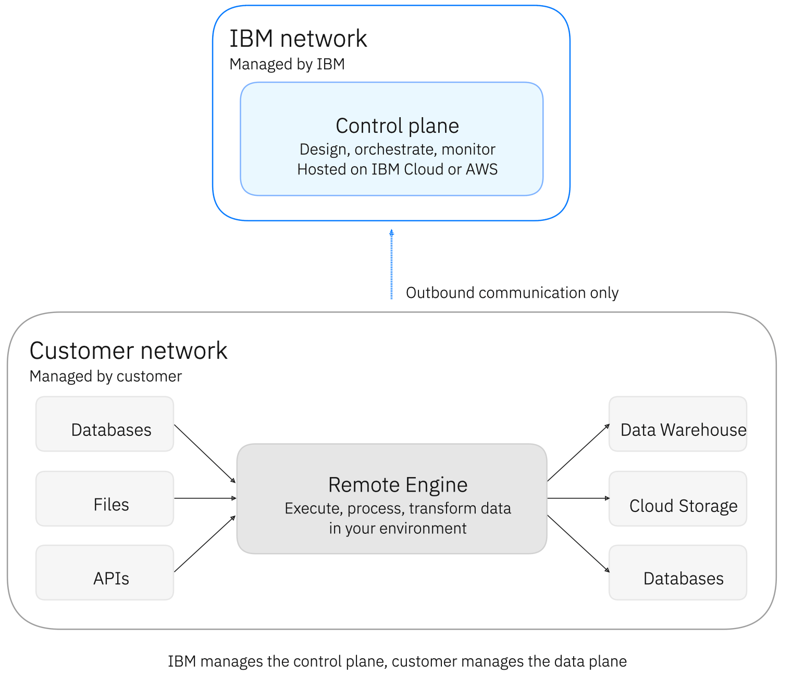{ .screenshot }

*The control plane runs in the IBM network and the remote engine runs in yours. They communicate through outbound calls only.*

!!! explainer "Control plane, data plane and remote engines"
    The **control plane** is watsonx.data integration on IBM Cloud. It stores
    your projects, flows, jobs and connections. The **data plane** is your own
    network, where the processing takes place. A **remote engine** is a container
    in the data plane that polls the control plane for work and processes it next
    to your data. The control plane never connects into your network.

Each business question also requires an appropriate runtime. This lab uses two
runtimes. The **remote batch engine** is designed for batch processing:
joins, lookups and calculations over large volumes of historical data. You use
it to determine *"which marketing campaigns pay for themselves?"* across 90
days of orders. The **streaming engine**, built on Apache Flink, is designed for
streaming: it processes live events individually as they arrive. You use it to
determine *"which shopping carts are worth winning back?"* while the shopper is
still on the site.

### 1.1 Use case overview

**Summit Outfitters** is an online retailer of outdoor equipment. As a data
engineer at Summit Outfitters, you receive two requests this quarter:

1. **Marketing:** *"We spend across search, social, email, affiliates and
   display. Which campaigns actually pay for themselves?"*
2. **E-commerce:** *"Shoppers add items to their cart and leave. Can we see that
   as it happens, and only chase the ones worth winning back?"*

The answer to the first question supports the second. Your batch flow on the
batch engine assigns each campaign a **verdict**: scale, hold or cut. Your
streaming flow on the streaming engine then attaches that
verdict to every live shopping cart.

### 1.2 Where Summit's data lives

In the Summit Outfitters scenario, the data is spread across two clouds and a
data center, with a remote engine deployed next to each source. In this lab,
one server hosts every source and both engines, so that you can see every
component. The flows behave the same way when each source is in its own
location.

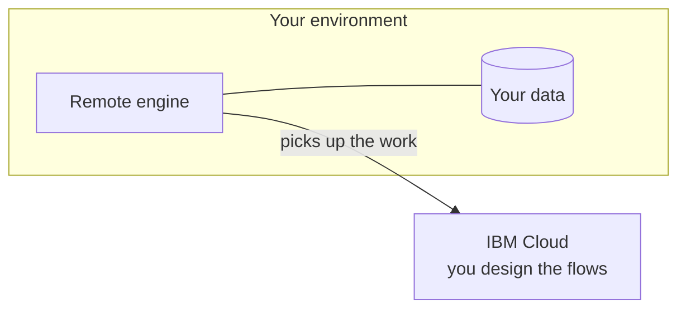

*You design in IBM Cloud. The engine in your environment picks up the work
and processes the data where it is.*

## 2 Getting started

!!! note "Before you start"
    **Keep every browser tab open.** The lab opens several tabs, and later
    steps return to tabs that you opened earlier. Do not close a tab unless a
    step tells you to.

    **Opening links.** To open a link from this guide, right-click it,
    select **Copy link address**, and paste it into a new tab of the browser
    on your main screen.

    **How to read the screenshots.** A red box or a red arrow marks the
    element to click. When one screen needs several actions, the letters
    **A**, **B** and **C** give their order. Names and numbers in the
    screenshots, such as the account name or a job ID, differ from yours.

--8<-- "labs/_signin.md"

### 2.2 Create a task credential

Create the task credential first. Every job in this lab runs under your own
identity through it. You create a task credential once per account; if one is
already listed, skip this section.

!!! explainer "Task credentials"
    A job can continue to run after you close your browser, so it cannot use
    your browser session. A **task credential** is an API key that the platform
    stores and uses whenever one of your jobs runs. Without a task credential, a
    run fails before it starts with the message *"Missing user API key: A user
    API key is required to run a job."*

1. Click the **profile** icon in the upper-right corner (A), then click
   **Profile and settings** (B).

    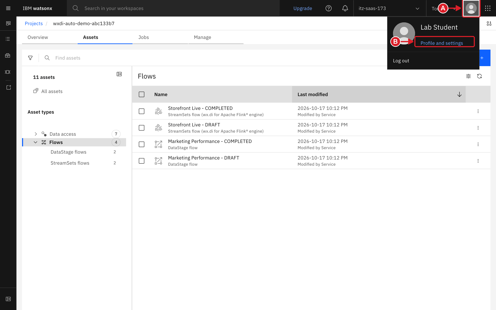{ .screenshot }

2. Click the **Task Credentials** tab.

    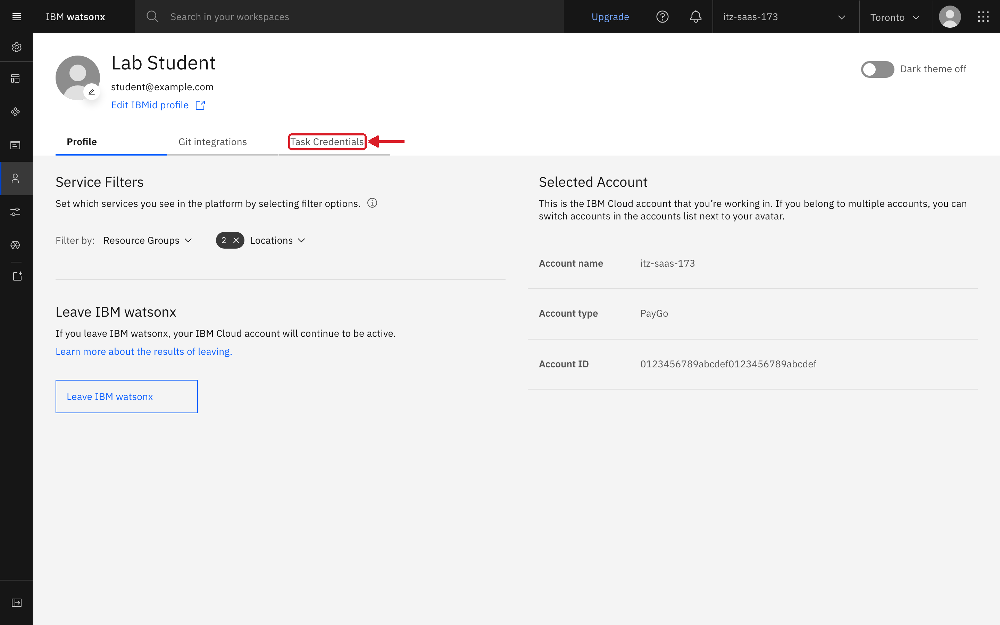{ .screenshot }

3. Click **Create task credential**.

    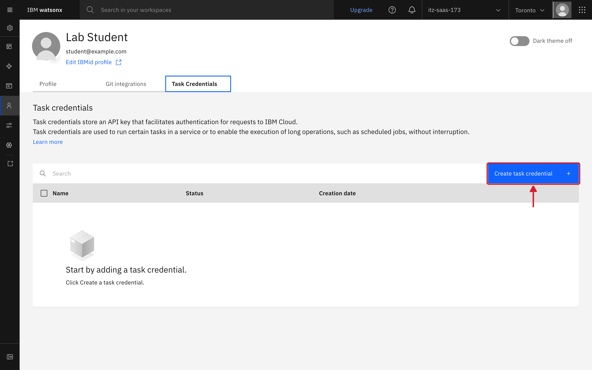{ .screenshot }

4. Enter a **Name**, for example `techxchange-lab` (A), and click **Create** (B).

    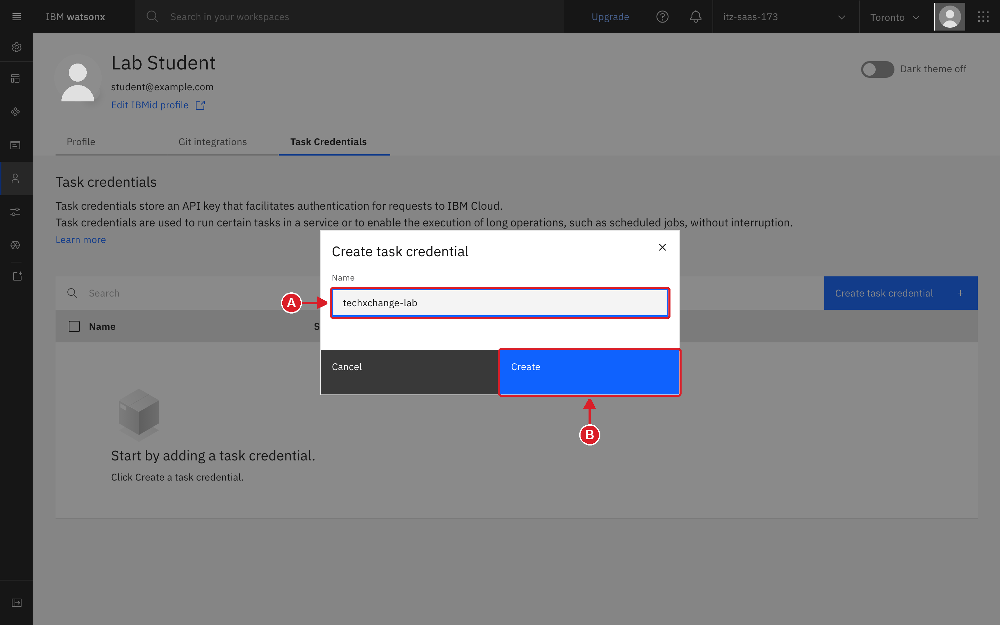{ .screenshot }

**Check your progress:** the credential is listed with a green status.

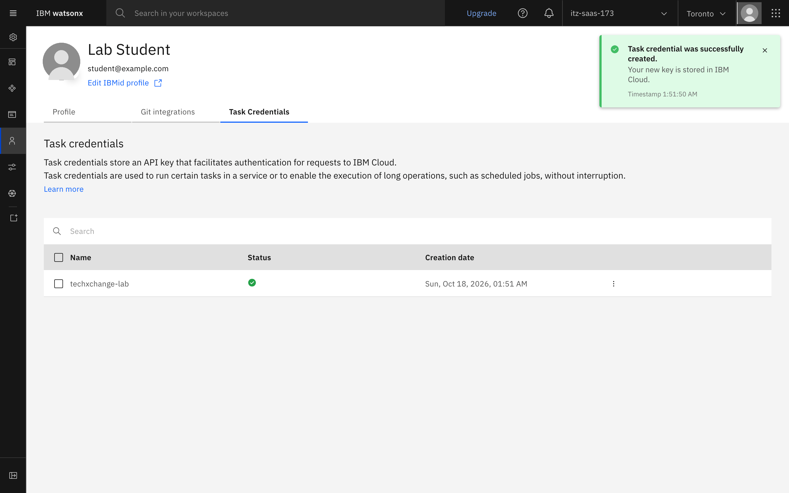{ .screenshot }

### 2.3 Open your project

Your environment is prepared before the session: the lab data, the simulated
website traffic and four flows are already in your project.

1. Click the **☰** menu in the upper-left corner, click **Projects**, and then
   click **All projects**.

2. In the list of projects, click your project. Its name starts with
   `wxdi-auto-demo-`.

    !!! warning "Do not use the project LAB-1861 Unstructured Data"
        Your account also contains a project named **LAB-1861 Unstructured
        Data**. It belongs to another lab. Ignore it: everything in this lab
        happens in the project whose name starts with `wxdi-auto-demo-`.

    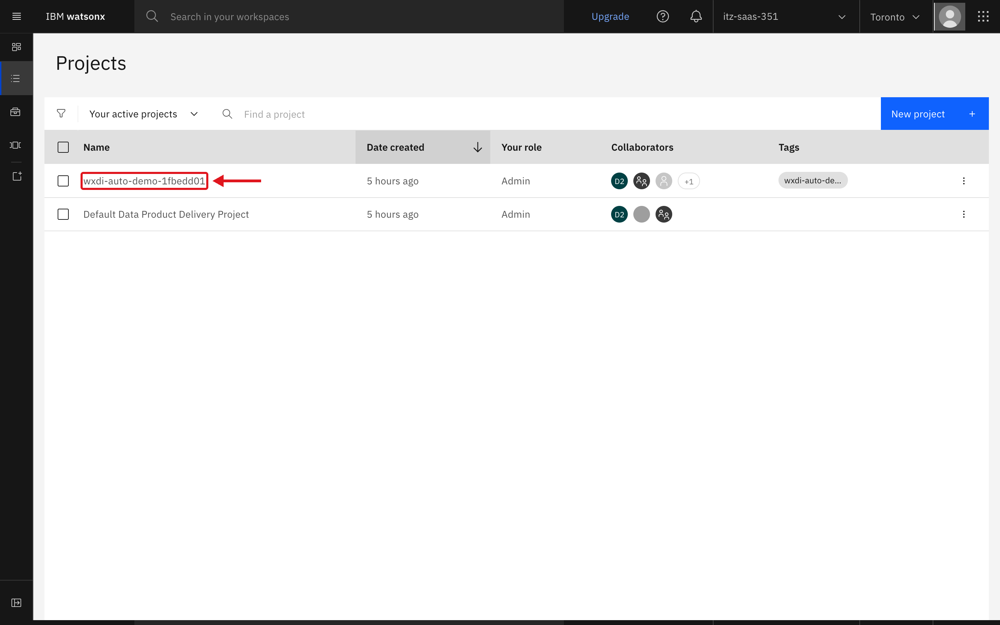{ .screenshot }

3. Click the **Assets** tab.

    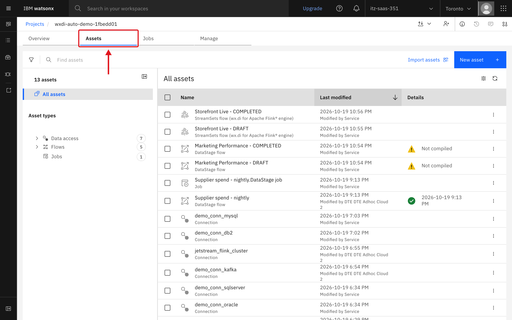{ .screenshot }

4. Under **Asset types**, click **Flows**.

    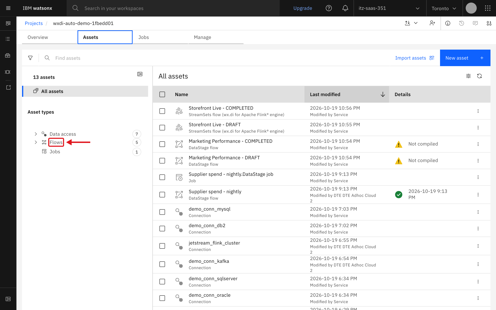{ .screenshot }

**Check your progress:** the four lab flows are listed.

{ .screenshot }

- **Marketing Performance - DRAFT** and **Storefront Live - DRAFT** are the
  starting flows. You run them first, in parts 3 and 4.
- **Marketing Performance - COMPLETED** and **Storefront Live - COMPLETED**
  are the finished flows. You explore and run them next. They answer the
  business questions.

!!! explainer "Projects, flows and jobs"
    A **project** is a shared team workspace that contains flows, connections and
    jobs. A **flow** is the design of a pipeline: the data to read, the
    processing to apply and the destination to write to. A **job** is a flow
    prepared to run on an engine. Each execution of a job produces a **run**,
    which has its own log and metrics.

### 2.4 The data sources in your project

Your project already contains a **connection** for each data source. The
flows use them to read and write data.

- **demo_conn_postgres** connects to the Summit order system in PostgreSQL:
  90 days of orders in the table `shop.orders_history`. On the canvas, the
  stage **Daily_orders** reads it.
- **demo_conn_mysql** connects to the marketing team's MySQL database and its
  campaign catalogue, table `campaigns`. The stage **Campaign_catalogue**
  reads it.
- The file **ad_spend.csv**, the daily export from the advertising platforms,
  sits on the local disk of the batch engine. The stage **Ad_spend_export**
  reads it.
- The Kafka topics **shop.clicks** and **shop.orders** carry the live website
  events. The stages **Storefront clicks** and **Storefront orders** read them.

!!! explainer "Connections"
    A **connection** is a saved, reusable set of credentials for a data
    source, stored in the project. A flow refers to the connection instead of
    a password. The engine uses the connection to reach the data from where
    the engine runs, so the data never travels to IBM Cloud.

## 3 Batch: which campaigns pay for themselves?

The marketing team invests in five channels and needs to know where to
allocate the next dollar. In this section, you run a batch flow on the
remote batch engine that answers this question. The flow combines three
sources in three formats.

**Current task:** the batch portion of the lab. You run a starting flow that
joins two sources. You then explore and run the finished flow, which adds the
third source, the calculations and the database target.

!!! explainer "Stages and links"
    Each box on the canvas is a **stage**. A stage is a source that reads data, a
    processing step that transforms data, or a target that writes data. The
    arrows are **links**, which carry rows from one stage to the next. After a
    run, each link displays the number of rows that passed through it.

### 3.1 Run the starting flow with preview

1. In the list of flows in your project, click **Marketing Performance -
   DRAFT**. The flow opens on the canvas.

    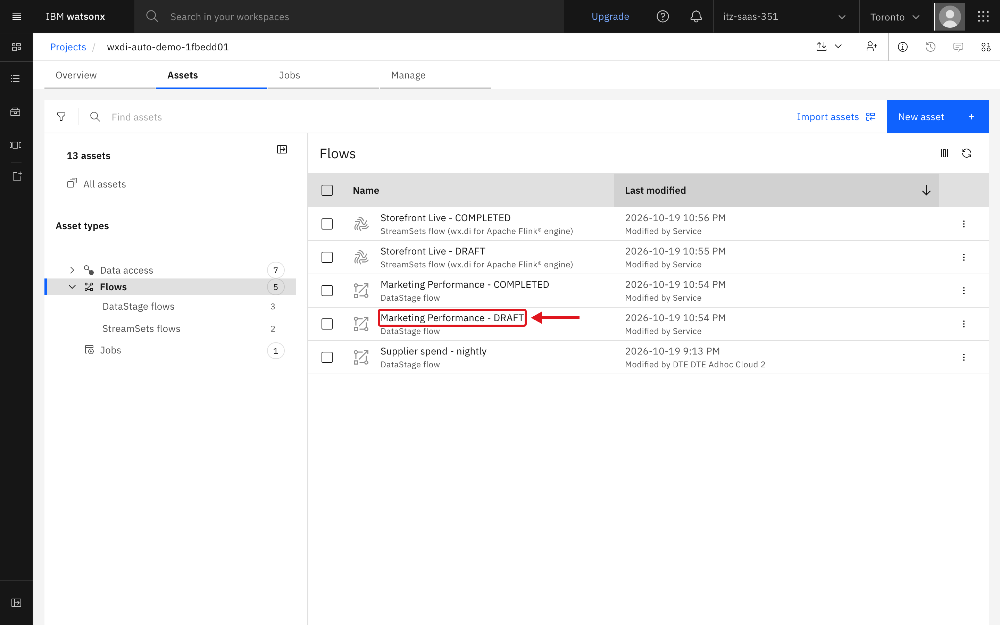{ .screenshot }

**Check your progress:** the canvas shows four stages.

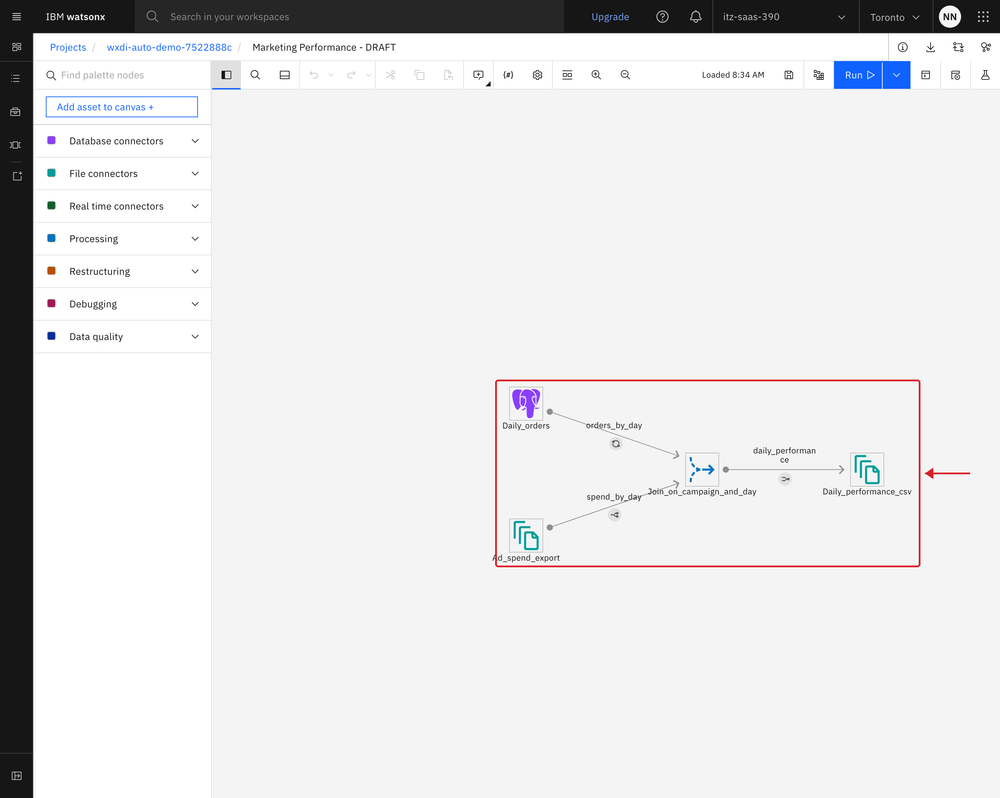{ .screenshot }

The flow already combines the first two sources:

- **Daily_orders** reads the order system in PostgreSQL and totals the orders
  and the revenue per campaign, per day.
- **Ad_spend_export** reads the CSV export from the advertising platforms
  directly from the local disk of the engine. The file never leaves the
  server that received it.
- **Join_on_campaign_and_day** matches the orders of each day with the
  advertising spend of the same day.
- **Daily_performance_csv** writes the result to a CSV file.

!!! explainer "Stages and links"
    Each box on the canvas is a **stage**: a source that reads data, a
    processing step that transforms it, or a target that writes it. The
    arrows are **links**, which carry rows from one stage to the next. After a
    run, each link shows how many rows passed through it.

!!! explainer "What happens when you run a flow"
    A flow is a design. Before an engine can run it, the design is
    **compiled**: translated into the program that the batch engine executes.
    The run is then queued as a **job**. Your remote engine picks up the job,
    reads the data next to it, and sends back only the status, the log and
    the row counts. **Run with preview** does the same, and also keeps a
    sample of the rows on every link so that you can inspect them.

2. Click the arrow next to **Run** (A), and then click **Run with preview**
   (B). The flow is compiled and runs on your remote engine. The run takes
   about one minute.

    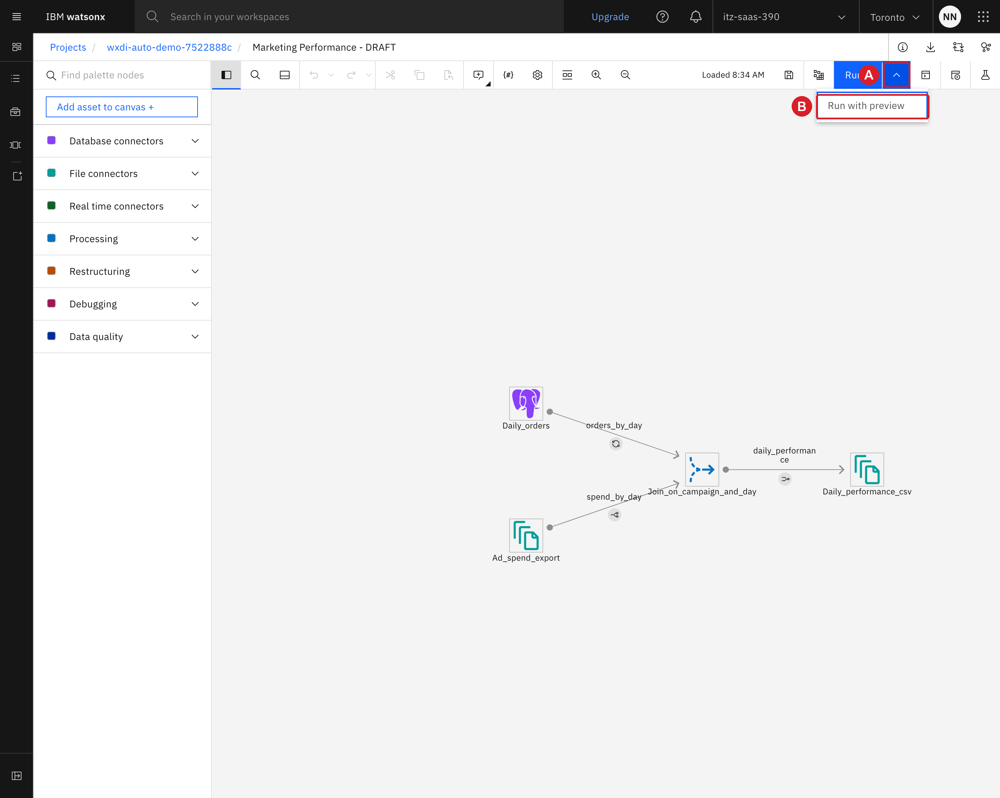{ .screenshot }

3. Wait until the green banner shows **Run successful.**

    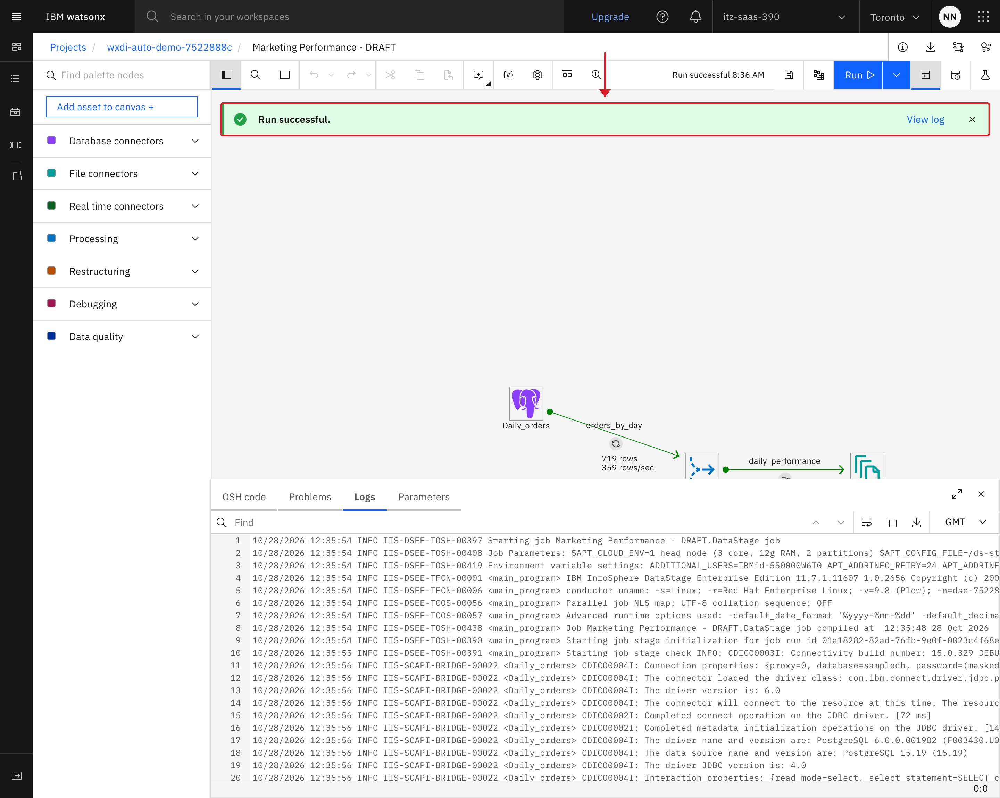{ .screenshot }

4. Click **Show bottom panel** in the toolbar. The panel opens below the
   canvas.

    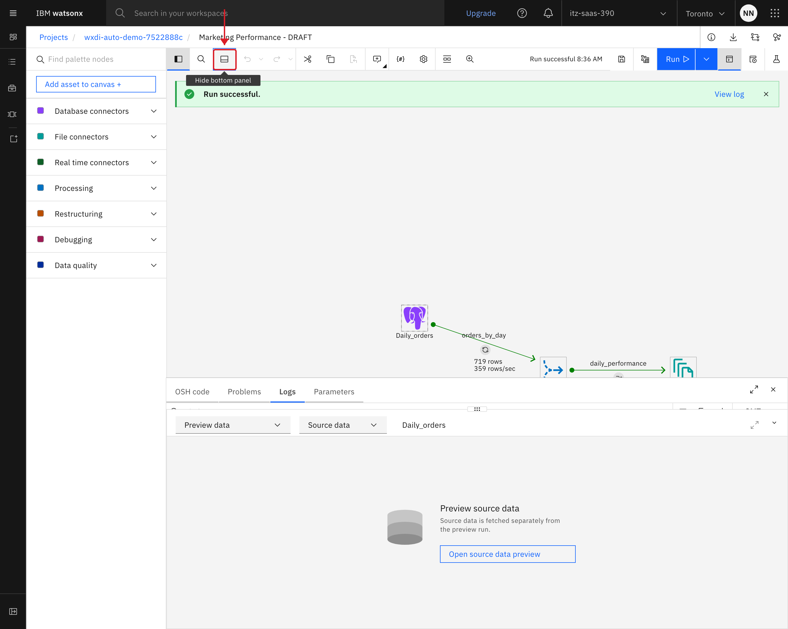{ .screenshot }

5. On the canvas, click **Join_on_campaign_and_day** once (A). The panel shows
   the rows that went into the join on the left (B) and the rows that came out
   on the right (C). The input on the left is **orders_by_day**: orders and
   revenue per campaign, per day, read from the order system.

    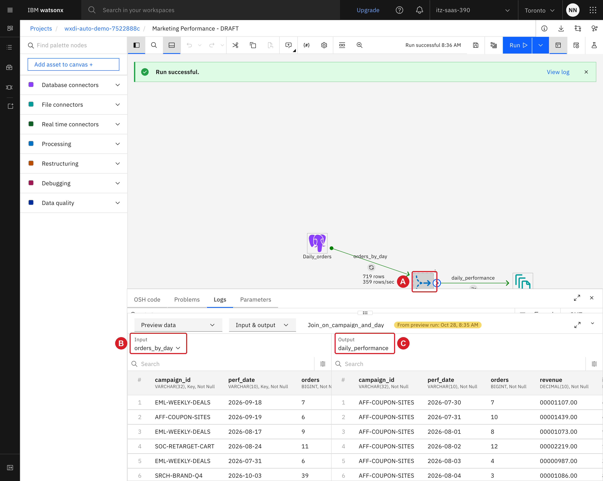{ .screenshot }

6. Click the **orders_by_day** list under **Input** (A), and then click
   **spend_by_day** (B).

    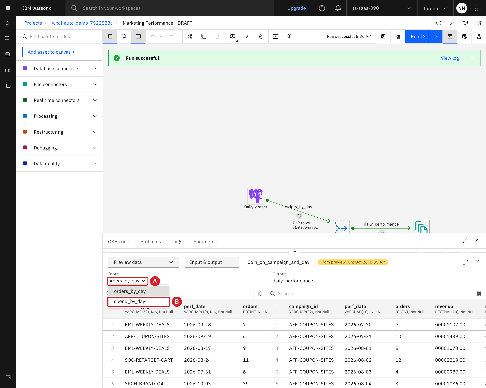{ .screenshot }

**Check your progress:** the left side now shows **spend_by_day** (A): the
impressions, clicks and spend per campaign, per day, read from the CSV export
(B). The output on the right combines both inputs: one row per campaign per
day, with orders, revenue, impressions, clicks and spend side by side.

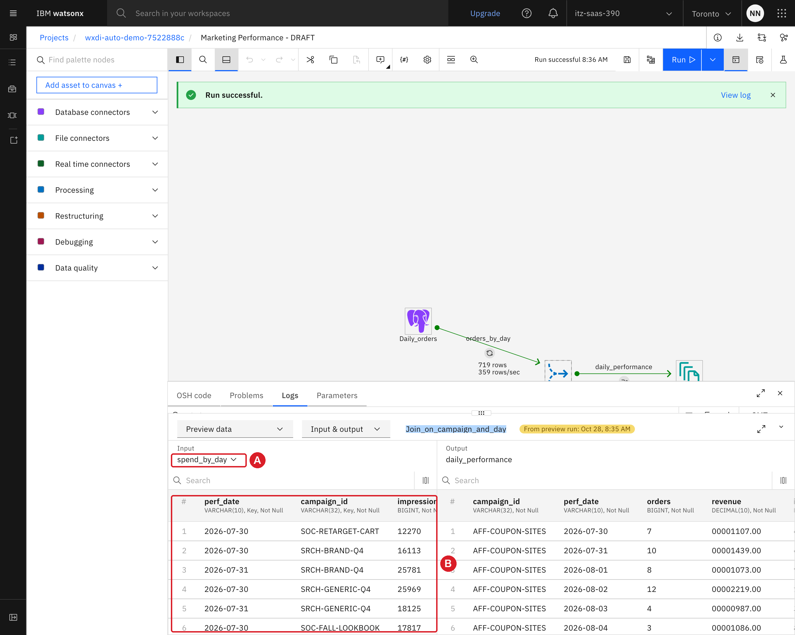{ .screenshot }

### 3.2 Prepare for a changing export file

The advertising platforms sometimes add a column to their daily export
without notice, for example a new **video_views** column. A pipeline that
lists every column by hand would need an update each time. **Runtime column
propagation** handles this automatically.

!!! explainer "Runtime column propagation"
    By default, a stage passes on only the columns that are defined in it.
    With **runtime column propagation (RCP)**, a stage also passes on the
    columns that it finds at run time but that are not defined in it. A new
    column in the export then flows through the pipeline without anyone
    editing the flow.

1. Click **Hide bottom panel**. On the canvas, double-click
   **Ad_spend_export**, and then click the **Output** tab.
2. Under **Columns**, select **Runtime column propagation** (A). Click
   **Save** (B).

    { .screenshot }

### 3.3 Explore and run the finished flow

The finished flow, **Marketing Performance - COMPLETED**, contains the
starting flow and four more stages. Together they answer the marketing
team's question. In this section, you examine each new stage and then run
the flow. You do not need to change anything.

1. In the breadcrumb at the top of the page, click the name of your project.
   Then click **Marketing Performance - COMPLETED** in the list of flows. The
   flow opens on the canvas.
2. **Review only: you do not change anything in this step.** Locate the four stages that the starting flow does not contain:
   **Campaign_catalogue** (A), **Add_campaign_details** (B),
   **Marketing_KPIs** (C) and **Campaign_performance_table** (D).

    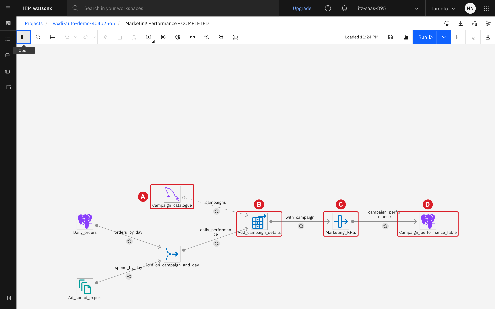{ .screenshot }

3. **Review only: you do not change anything in this step.** Double-click **Campaign_catalogue**, and then click the **Output** tab (A).
   This stage reads the campaign catalogue from the marketing team's MySQL
   database: the name, channel, objective and owner of each campaign (B).
   Click **Cancel**.

    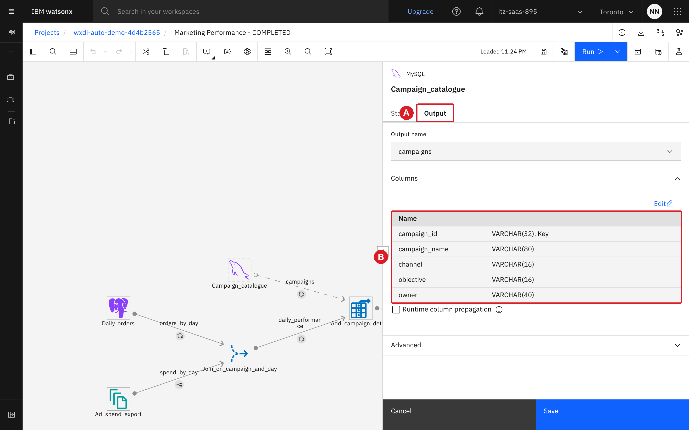{ .screenshot }

4. **Review only: you do not change anything in this step.** Double-click **Add_campaign_details**. This **Lookup** stage adds the
   catalogue details to each row of the join. The **Key expression** is
   **campaign_id** (A), the column that both inputs share. **Lookup failure**
   is set to **Continue** (B), so a day with an unknown campaign is kept
   instead of failing the job. Click **Cancel**.

    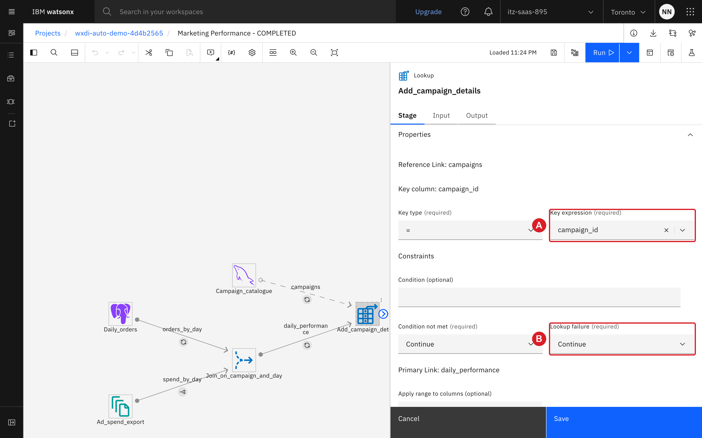{ .screenshot }

    !!! explainer "Lookups"
        A **Lookup** stage adds details to each row from a reference table. The
        solid link carries the rows to enrich. The dashed **reference** link
        carries the table that supplies the details. The **key** is the column
        that both inputs share.

5. Double-click **Marketing_KPIs**, and then click the **Output** tab. This
   **Transformer** stage calculates metrics per campaign, per day. Scroll to
   the end of the **Output** list. Two metrics are already there:
    - **roas**: return on ad spend (ROAS), which is revenue divided by spend. A
      value of 3.0 means that every $1 of advertising generated $3 of sales.
    - **cpa_usd**: cost per acquisition (CPA), which is the advertising cost of
      each order.

    The third metric, the click-through rate (CTR), is missing. You add it
    now.

    !!! explainer "Derivations"
        Each output column of a Transformer has a **derivation**: a formula
        built from the input columns, written as `<input link>.<column>`. The
        input link of this stage is **with_campaign**. `If ... Then ... Else`
        protects against a division by zero on a day without impressions.

6. Click **Add column** (A). A new row named **COLUMN_1** appears at the end
   of the list (B).

    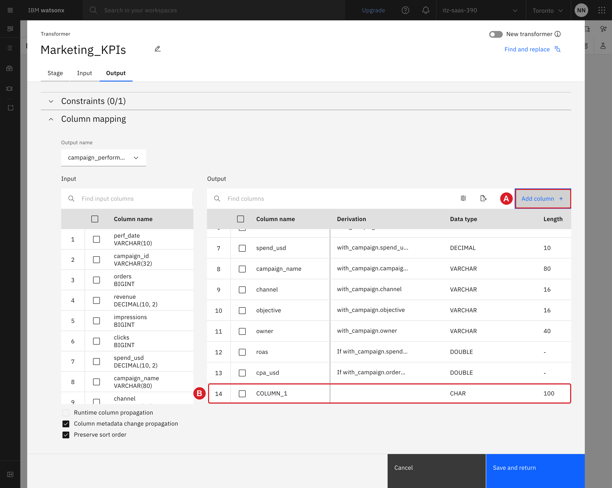{ .screenshot }

7. Double-click **COLUMN_1** and type `ctr_pct` (A). Then double-click the
   empty **Derivation** cell of the same row, type the following formula, and
   press **Enter** (B):

    ```text
    If with_campaign.impressions > 0 Then 100.0 * with_campaign.clicks / with_campaign.impressions Else 0
    ```

    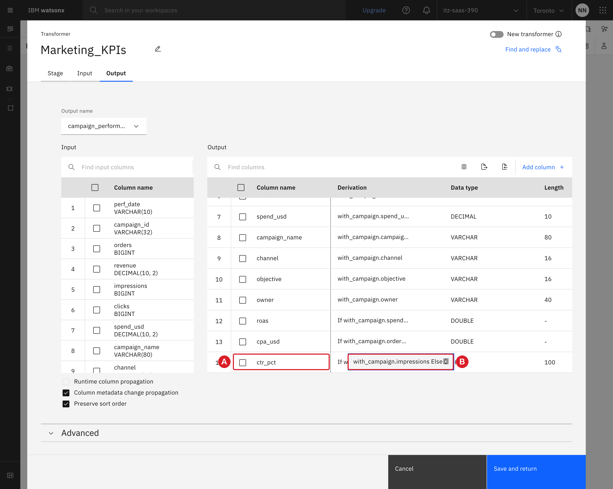{ .screenshot }

8. Click the **Data type** cell of the row and select **DOUBLE**.

**Check your progress:** the row **ctr_pct** shows your derivation and the
type **DOUBLE** (A). Click **Save and return** (B).

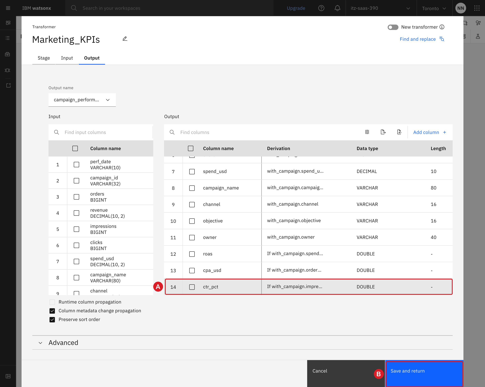{ .screenshot }

9. **Review only: you do not change anything in this step.** Double-click **Campaign_performance_table**. This stage loads the results
   into the PostgreSQL table **shop.campaign_performance**, which the
   marketing team reads its reports from. Each run empties the table first,
   so repeated runs do not duplicate rows. Click **Cancel**.

    { .screenshot }

10. Click **Compile** in the toolbar. Compiling turns the flow, now with your
    new column, into the program that the engine runs.

    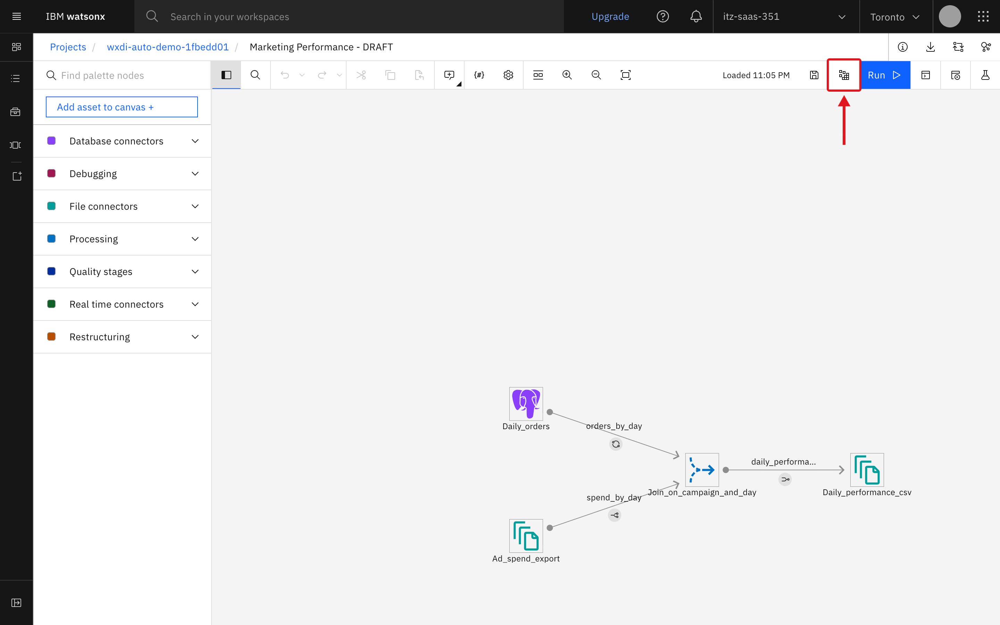{ .screenshot }

11. Wait until the green **Compile successful** banner appears, then click
    **Run flow** in the banner. The run takes about one minute.

**Check your progress:** the banner displays **Run successful** (A). The link
into **Campaign_performance_table** shows about **720 rows** (B), one per
campaign per day. The dashed link from the campaign catalogue shows **8
rows**, one per campaign.

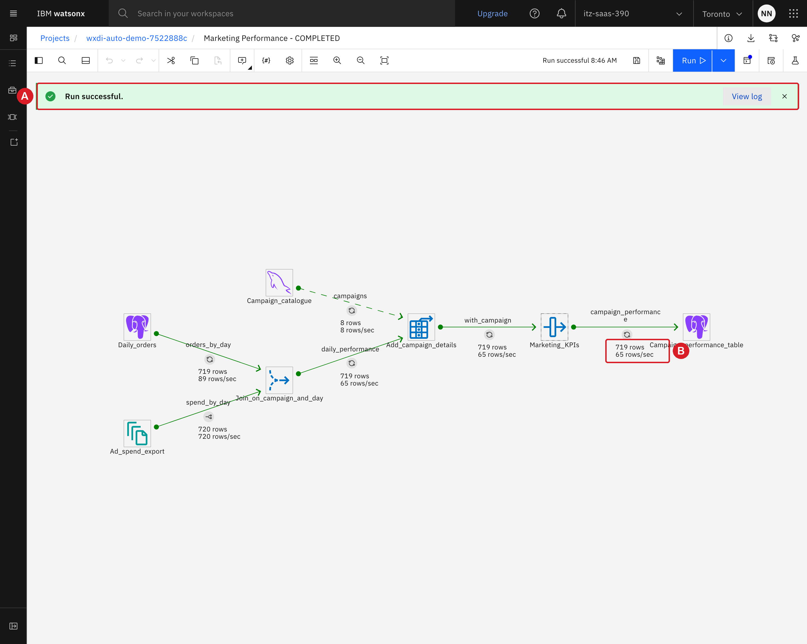{ .screenshot }

!!! explainer "Three sources, three formats, one engine"
    The flow reads from PostgreSQL, MySQL and a CSV file. The batch engine
    connects to each source locally through the connections in your project. The
    flow does not specify *where* it runs. The same flow can run on an engine in
    another cloud, next to the data in that cloud.

### 3.4 Review the results

The table now contains one row per campaign per day, including the three
metrics that the flow calculated. In this section, you review the results from the
canvas.

1. Double-click **Campaign_performance_table**, scroll to the bottom of the
   **Stage** tab and click **Preview data**. The preview reads the table that
   the flow loaded.

    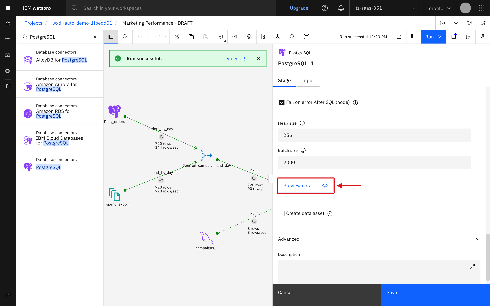{ .screenshot }

2. In **Search for value**, enter `DISP-PROSPECTING` and press **Enter**. Scroll
   the table to the right until the **roas** (A), **cpa_usd** (B) and
   **ctr_pct** (C) columns are visible.

    { .screenshot }

    Review the first row. On that day, the display prospecting campaign spent
    approximately $1,629 on advertising and generated $626 in orders. The
    **roas** value is 0.38, which means that every $1 of advertising returned
    38 cents. The **cpa_usd** value is approximately $407, which means that
    each order cost $407 in advertising, far more than the value of an order.
    The **ctr_pct** value is approximately 2%, a typical click-through rate.
    Shoppers click the ads but do not complete a purchase. This campaign loses
    money every day.

3. In **Search for value**, enter `EML-VIP-EARLY` and press **Enter**.

    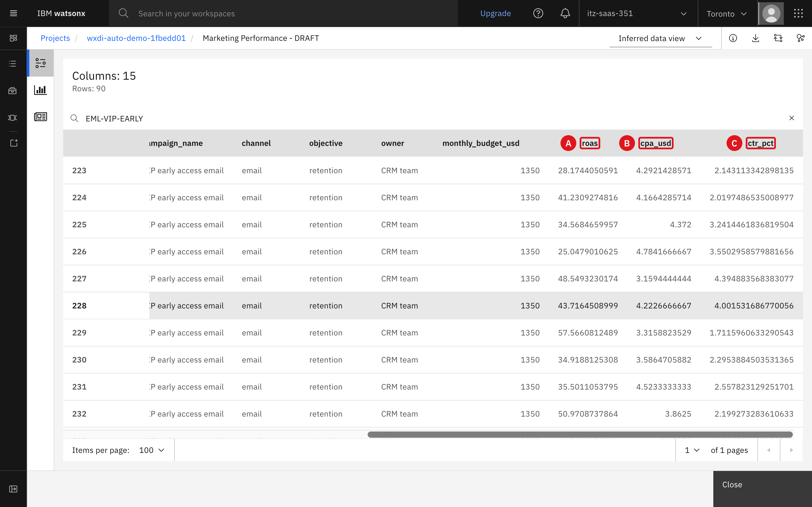{ .screenshot }

    On that day, the VIP early access email campaign spent approximately $60
    and generated $1,693. The **roas** value (A) is 28, which means that every
    $1 returned $28. The **cpa_usd** value (B) shows that each order cost
    approximately $4. The click-through rate, **ctr_pct** (C), is also
    approximately 2%, the same as the display campaign. Based on
    click-through rate alone, the two campaigns appear equivalent. Return on ad
    spend shows that one campaign is profitable and the other loses money.

4. Click **Close**, then click **Cancel**.

Your results feed a **campaign scorecard**: a PostgreSQL view that totals the
90 days for each campaign and assigns a verdict. A campaign that returns $4 or
more for every $1 spent receives the verdict **scale**, which means increase
its budget. A campaign that returns less than its cost receives the verdict
**cut**. A campaign between these thresholds covers its cost by a small margin
and receives the verdict **hold**.

The email campaigns and brand search return several times their cost. Display
prospecting returns approximately 50 cents for every $1 spent, so its verdict
is *cut*. This result is the recommendation for the marketing team. In
part 4, you apply it to live data.

### 3.5 Monitor your remote engine

Your jobs ran on the batch engine in your environment, not in IBM Cloud. In
this section, you monitor the engine from the project while it processes a
job. You use two browser tabs side by side: one for the flow and one for the
engine.

1. In the breadcrumb in the upper-left corner, **right-click** the name of
   your project and select **Open link in new tab**. The flow remains open in
   the current tab.

    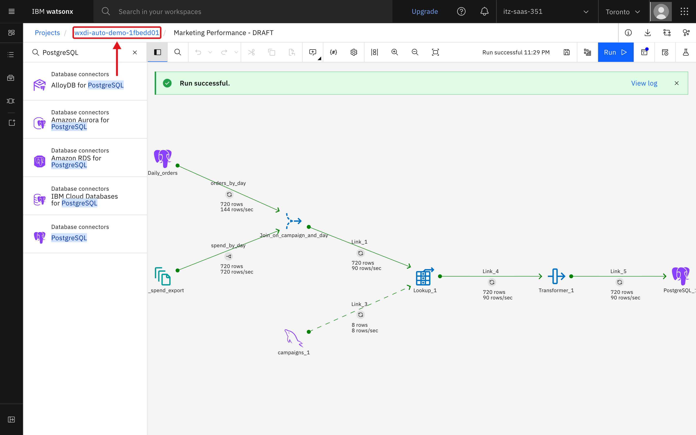{ .screenshot }

2. Switch to the new tab and click the **Manage** tab.

    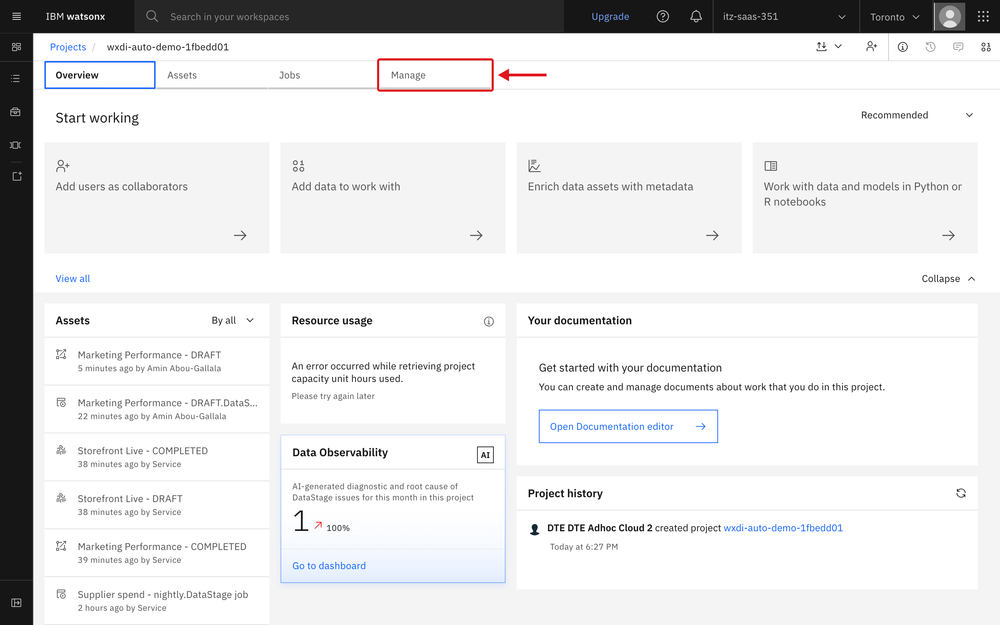{ .screenshot }

3. In the left menu, click **DataStage**.

    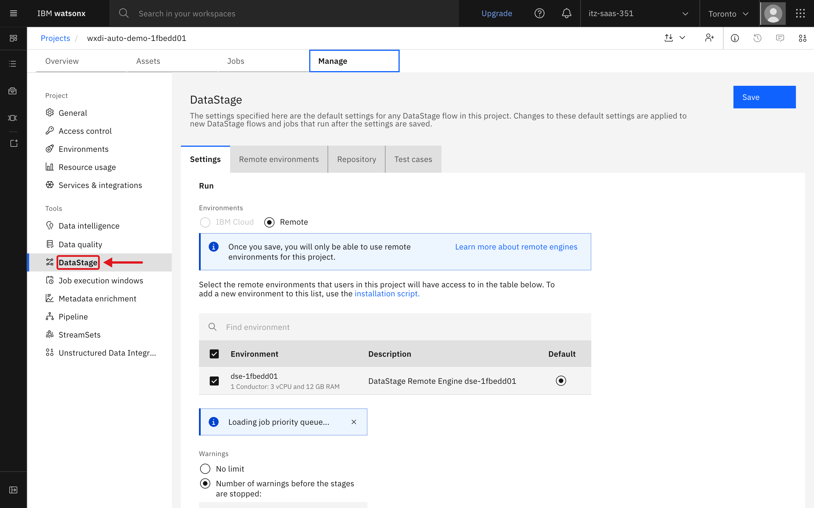{ .screenshot }

4. Click the **Remote environments** tab.

    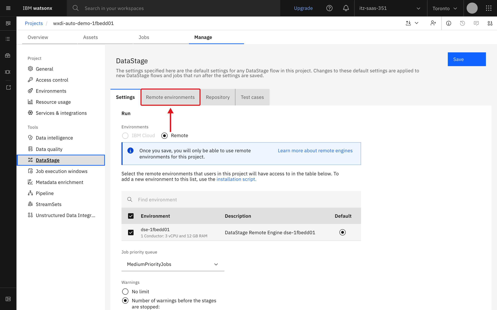{ .screenshot }

5. **Review only: you do not change anything in this step.** Review the details of your remote engine: version, status, uptime, and CPU,
   memory (RAM) and disk usage. When the engine is idle, its CPU usage is close
   to 0%.

    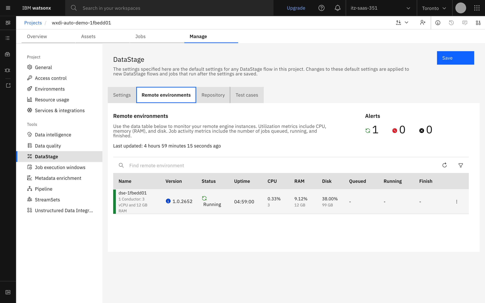{ .screenshot }

6. Switch to the tab that contains the **Marketing Performance - COMPLETED** flow
   and click **Run** in the toolbar. The flow is already compiled, so the job
   is submitted directly to the engine.

7. Switch to the **Remote environments** tab. The table does not refresh
   automatically. Click the **Refresh** icon approximately every 5 seconds.

    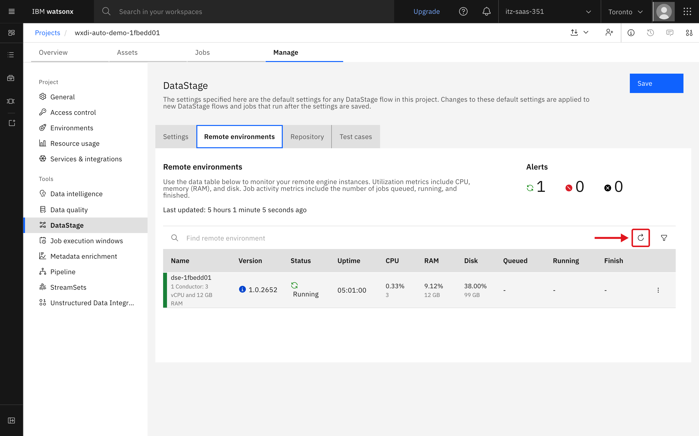{ .screenshot }

8. Within approximately one minute, the **CPU** usage of the engine increases
   while the job runs. The usage decreases when the job completes.

    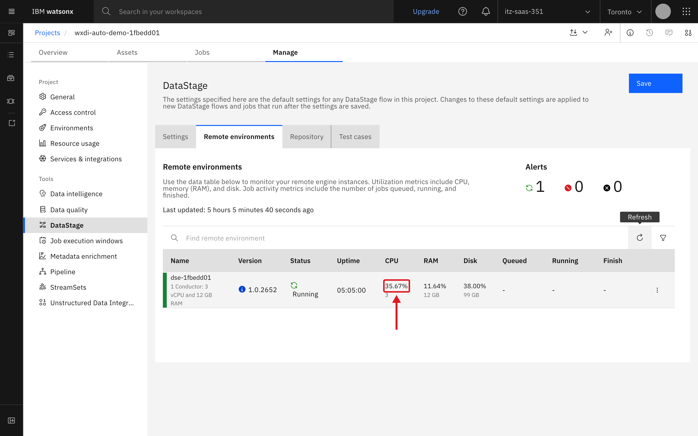{ .screenshot }

IBM Cloud cannot connect to the engine. The engine log, which is available from
the control plane, shows how the job reached the engine.

9. Click the **⋮** icon at the end of the engine row, then click **View logs**.

    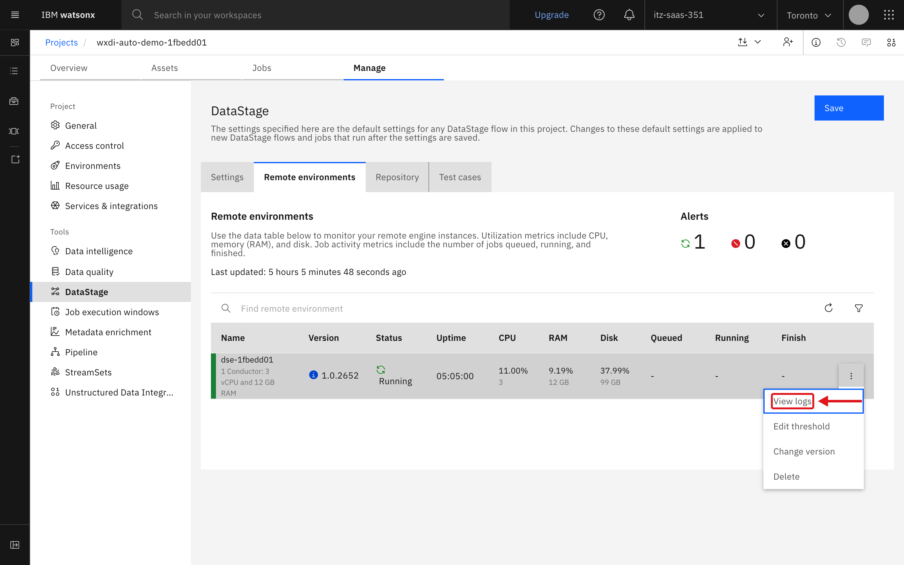{ .screenshot }

10. Scroll to the bottom of the log. Review the entries that start at the time
    you clicked **Run**:

    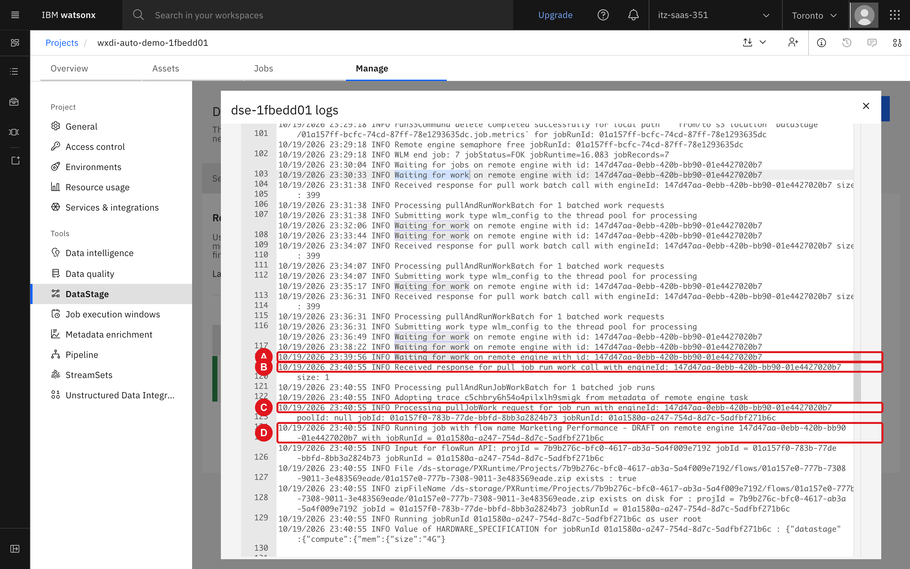{ .screenshot }

    - **A** - `Waiting for work`: the engine polls the control plane for work
      approximately once per minute.
    - **B** - `Received response for pull job run work call`: the control
      plane held the run request that you submitted, and the engine received
      the request on its next poll.
    - **C** - `Processing pullJobWork request`: the engine retrieves the job.
      Because the flow is already compiled, the engine skips compilation. A
      flow that is not compiled is compiled first, on the engine.
    - **D** - `Running job with flow name Marketing Performance - COMPLETED`:
      the engine runs the job. The engine connects to PostgreSQL, MySQL and
      the CSV file, performs the join, lookup and calculations, and loads the
      results. All processing takes place next to the data.

    The entries after **D** report the status and metrics of the run. The
    engine sends only status, logs and metrics to the control plane. Your data
    rows remain in your network. Because the engine initiates all connections,
    it can operate behind a firewall in any cloud or data center without an
    open inbound port.

11. Close the log by clicking the **X**.

## 4 Streaming: detect abandoned carts in real time

Most shoppers who add an item to their cart leave without completing a
purchase. Some of these abandoned carts justify a reminder or an offer, and
others do not. The scorecard from part 3 identifies which
carts to pursue. A cart from a **scale** campaign is worth pursuing, and a cart
from a **cut** campaign is not.

In this part, you run a streaming flow on the streaming engine, built on
Apache Flink. The flow monitors website activity in real time and applies your
batch scorecard to every cart.

The following diagram shows how a streaming flow runs. You design the flow on
the canvas (01). The streaming engine
translates the flow into an Apache Flink job (02). The Flink platform in your
environment runs the job and reports its status and metrics to the control
plane (03).

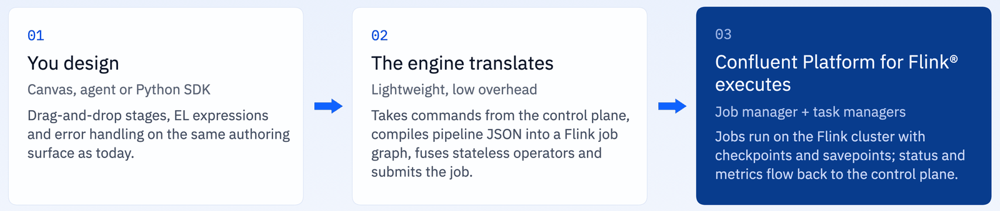{ .screenshot }

*You design the flow, the engine translates it into a Flink job, and the Flink platform in your environment runs the job.*

**Current task:** the streaming portion of the lab. You run a starting flow
that joins carts to orders. You then explore and run the finished flow, which
adds the totals per campaign and the verdict from part 3.

!!! explainer "Kafka topics and events"
    The website sends every click and every order to **Kafka** as an **event**:
    a small JSON message sent at the moment the action occurs. Events of the same
    type are written to the same **topic**, such as `shop.clicks` and
    `shop.orders`. A streaming flow reads a topic continuously and processes each
    event as it arrives, so the results are only seconds old.

!!! explainer "Apache Flink in five ideas"
    **A stream is unbounded.** A batch job reads a table and then completes. A
    Flink job runs continuously and processes each event as it arrives.

    **Event time.** Every event carries the time at which it occurred (here
    `event_ts`). Flink uses this time instead of the arrival time, so a late
    click is still assigned to the correct minute.

    **Watermarks.** Flink cannot wait indefinitely for late events. A
    **watermark** is the point in event time up to which Flink considers all
    events received. Here, the watermark is 10 seconds behind the newest event.
    When the watermark passes the end of a window, Flink closes the window and
    emits its result.

    **Windows.** To aggregate a stream, Flink divides it into time intervals. A
    **tumbling window** is a sequence of consecutive, non-overlapping intervals,
    here 5 minutes each. Every event belongs to exactly one interval.

    **State and checkpoints.** While a window is open, Flink holds the running
    totals in memory. This data is called **state**. Flink saves the state at
    regular intervals; each save is a **checkpoint**. If the job stops, it
    resumes from the last checkpoint.

!!! explainer "The streaming engine"
    The streaming engine runs streaming flows as Apache
    Flink jobs on a Flink cluster in your own environment, next to Kafka. You
    design the flow on the same type of canvas as other flows in your project.
    Flink handles windows, joins between two live streams, and late or
    out-of-order events.

### 4.1 Run the starting flow

The **Storefront Live - DRAFT** flow already answers the first question:
*"did this cart turn into an order?"*

- **Storefront clicks** reads every website click from Kafka.
- **Add-to-cart only** keeps only the add-to-cart clicks.
- **Storefront orders** reads every order from Kafka.
- **Did the cart become an order?** is a **Stream Join** stage. It matches
  each cart with an order from the same shopping session within 5 minutes.
- **shop.cart_conversion** writes the result to Kafka.

In the following steps, you open the flow, examine the join and run the flow.

1. Click the name of your project in the breadcrumb at the top of the page,
   click the **Assets** tab, and then click **Flows**.

    { .screenshot }

2. Click **Storefront Live - DRAFT**. The flow opens on the canvas. If a
   cookie banner appears at the bottom of the page, click **Accept All**.

    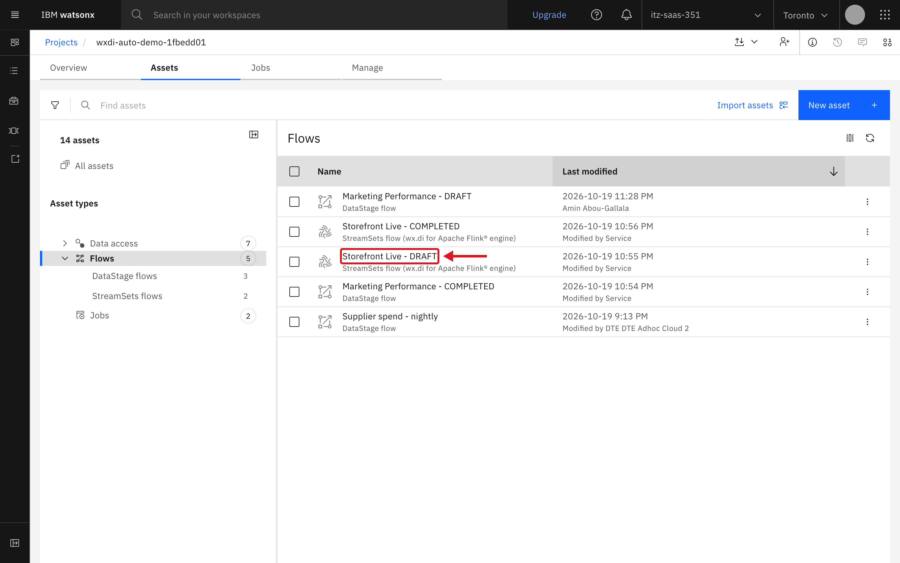{ .screenshot }

3. **Review only: you do not change anything in this step.** Click **Did the cart become an order?** once. The stage settings open on
   the right.

    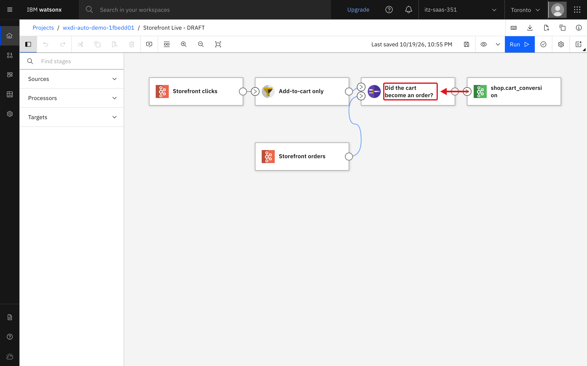{ .screenshot }

4. **Review only: you do not change anything in this step.** Review the **Join Type**, **LEFT** (A), and the **Join Keys**,
   **/session_id** on both sides (B). A **LEFT** join retains every cart,
   including carts without an order. Carts without an order are the abandoned
   carts.

    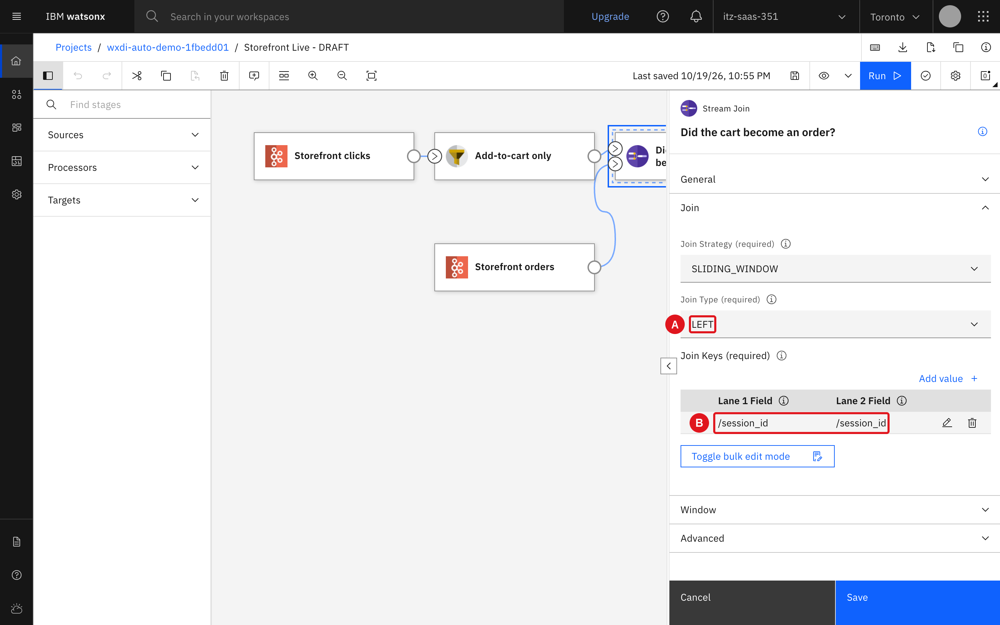{ .screenshot }

5. **Review only: you do not change anything in this step.** Click **Window**. **Window Size** is 300000 milliseconds (5 minutes). A cart
   and its order must occur within 5 minutes of each other to match. Click
   **Cancel**.

    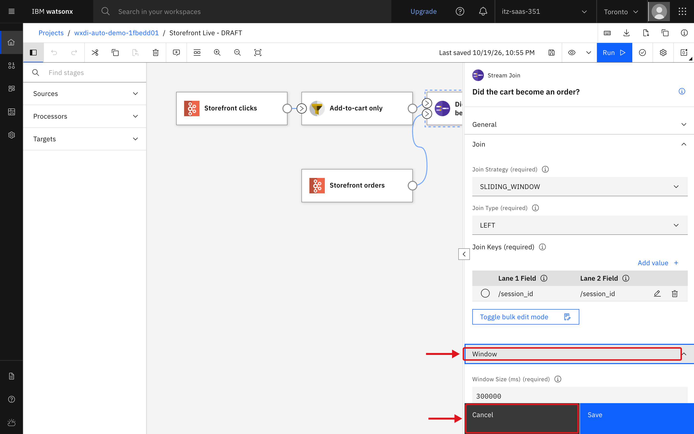{ .screenshot }

    !!! explainer "Joining two live streams"
        A database join compares two static tables. A **Stream Join** compares
        two continuous streams, so it requires a time limit. When the 5-minute
        limit expires, each cart without a matching order is emitted with empty
        order fields.

6. Click the **Validate** checkmark in the toolbar. Validation checks every
   stage before the flow is submitted to the engine.

    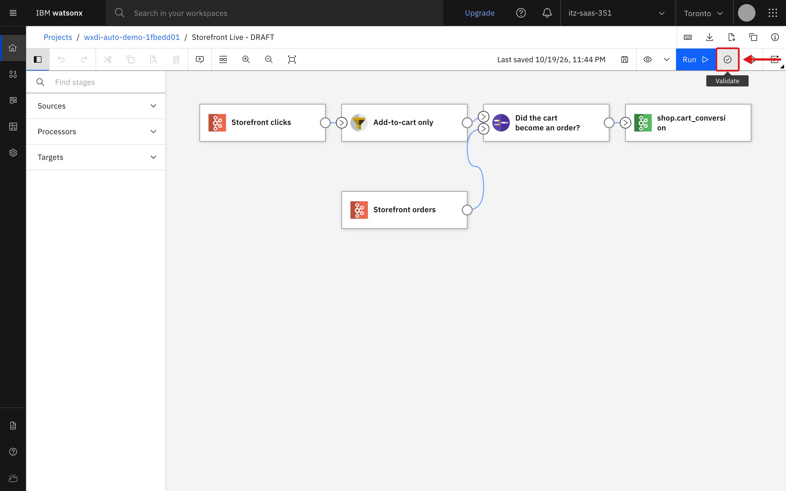{ .screenshot }

7. Verify that the banner displays **Validation successful, no issues found**.

    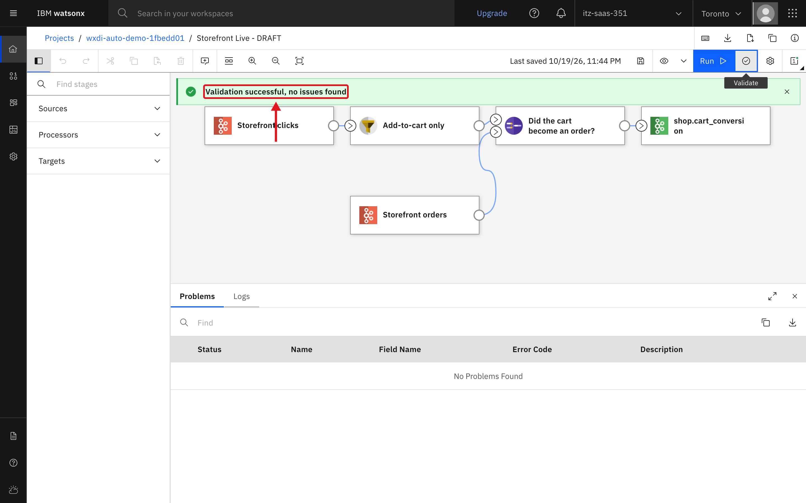{ .screenshot }

8. Click **Run** in the toolbar.

    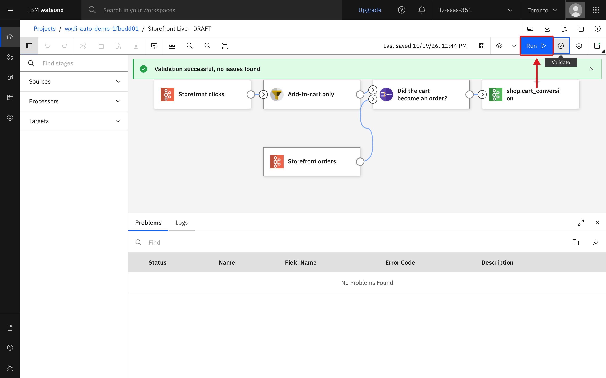{ .screenshot }

9. Wait until the status changes to **Job Running**, which indicates that
   Flink is starting the job. The first results are emitted when the first
   5-minute window closes.

    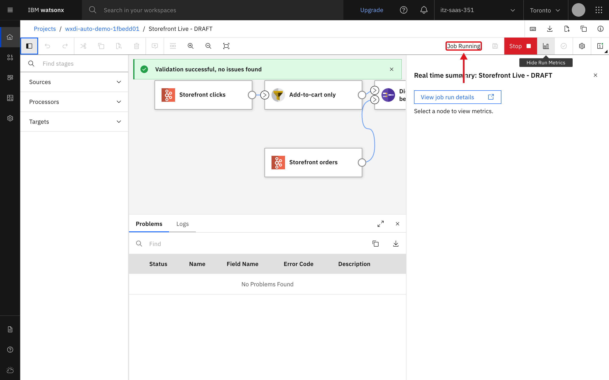{ .screenshot }

**Check your progress:** after 5 to 10 minutes, click **Did the cart become an
order?** again. Until the first window closes, the counts display a dash. After
the window closes, the **Real time summary** displays the carts received (A)
and the joined results emitted (B).

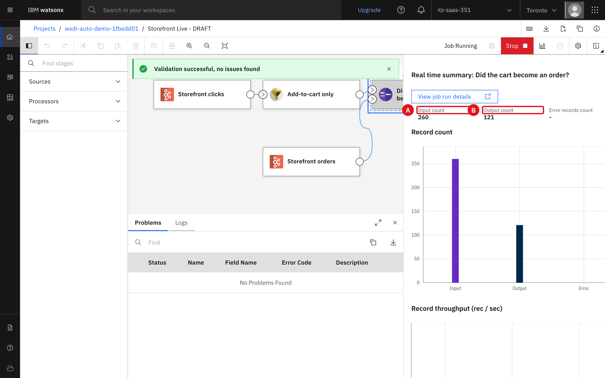{ .screenshot }

### 4.2 View your job on Apache Flink

The Flink console confirms that your flow runs in your environment, next to
Kafka. Each job runs on its own dedicated Flink cluster. You open the cluster
from Control Center, the web console of the Kafka and Flink platform. Leave
the flow running.

1. Go to the browser tab that contains your TechZone reservation page. Under
   **Post-deployment text output**, click **Open the Demo Builder**. The
   Demo Builder opens in a new tab. This is the only part of the lab that
   uses the Demo Builder: it shows the address of your environment's
   consoles.

    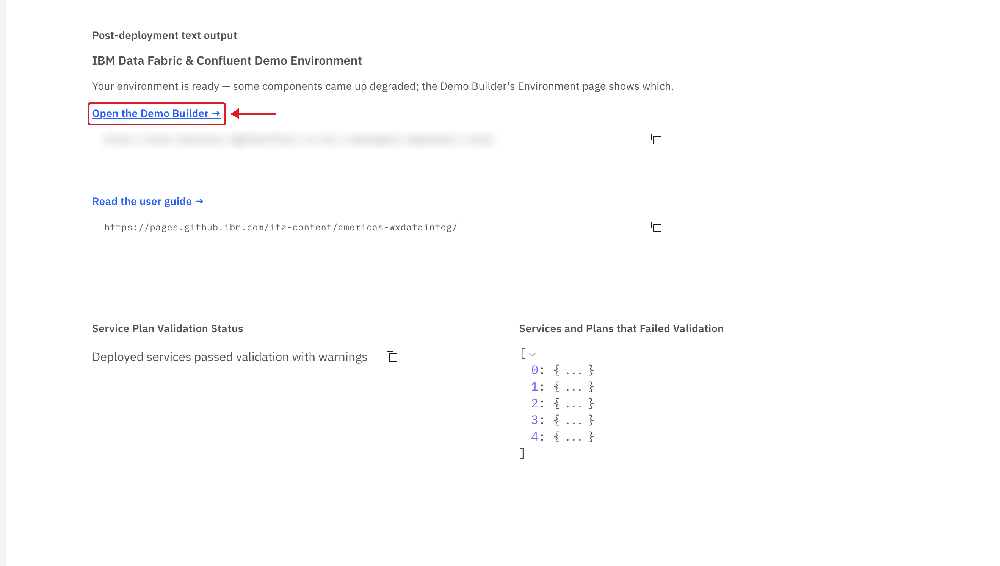{ .screenshot }

2. Click **Environment**.

    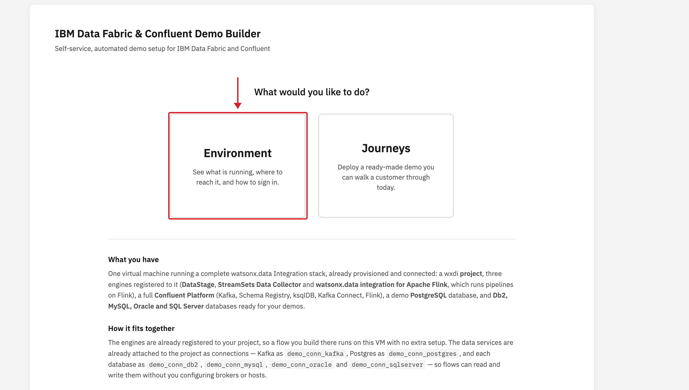{ .screenshot }

3. Click the **Confluent Platform** tile.

    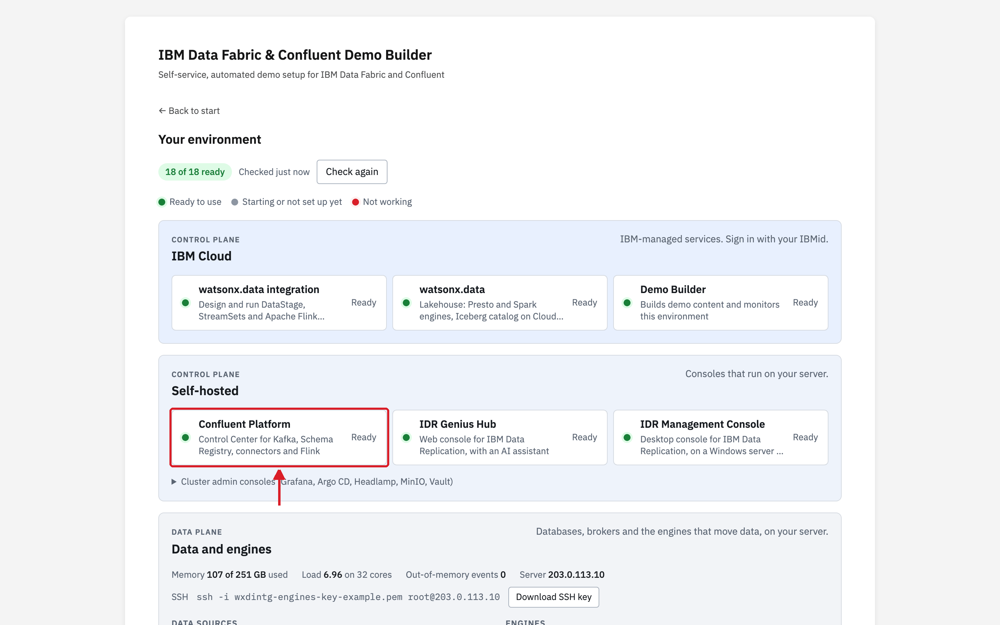{ .screenshot }

4. Click **Open Control Center** (B). Control Center opens in a new tab.

    { .screenshot }

5. Sign in with the username `admin` and the password `IBMDem0s1` (the
   character after "Dem" is the digit zero, not the letter O).

6. In the left menu, click **Flink**.

    { .screenshot }

7. Click **flink-env**, which is your Flink environment.

    { .screenshot }

8. Click **Applications**.

    { .screenshot }

9. Locate your job: the application whose name starts with `app-` (A) and
   whose state is **Running**. Click **View Flink UI** (B) for that
   application.

    { .screenshot }

10. The **Apache Flink Dashboard** for the job cluster opens. Under **Running
   Job List**, click your job.

    { .screenshot }

11. Verify that the job status is **RUNNING** (A). The graph shows each step of
   your flow as a Flink **operator**, from the two Kafka sources on the left to
   the writer on the right. Scroll down to the table. The **Records Sent**
   value (B) increases as shoppers click.

    { .screenshot }

    !!! explainer "One flow, one Flink job"
        When you click **Run**, the streaming engine converts
        your flow into a Flink job and starts a dedicated Flink cluster for it,
        next to Kafka. Each box in the graph is an **operator** that is generated
        from your stages. When you stop the flow, the cluster is removed.

12. Switch to the browser tab that contains the **Storefront Live - DRAFT**
    flow. Keep the Control Center tab open; you return to it in section 4.4.

### 4.3 Explore and run the finished flow

The join produces one record per cart, which is too detailed for a marketing
team that plans by campaign. The finished flow, **Storefront Live -
COMPLETED**, adds two stages to the starting flow. The first totals the carts
per campaign every 5 minutes. The second attaches the verdict that the batch
flow calculated in part 3. In this section, you examine both stages and then
run the flow.

1. In the **Storefront Live - DRAFT** flow, click **Stop**, and wait until the
   **Run** button is displayed again. Only one flow runs at a time in this
   lab.
2. In the breadcrumb at the top of the page, click the name of your project.
   Then click **Storefront Live - COMPLETED** in the list of flows. The flow
   opens on the canvas.
3. **Review only: you do not change anything in this step.** Locate the two stages that the starting flow does not contain: **Cart
   value by campaign** (A) and **Campaign verdict** (B).

    { .screenshot }

4. **Review only: you do not change anything in this step.** Click **Cart value by campaign** once. The stage settings open on the
   right. This **Windowing Aggregator** stage uses a **TUMBLING** window of
   **300000** milliseconds, which is 5 minutes (A). **Grouping** is set to
   **/cart_campaign_id** (B), so the stage emits one result per campaign
   every 5 minutes.

    { .screenshot }

5. **Review only: you do not change anything in this step.** Expand **Aggregations**. The three entries calculate the **number** of
   carts (**carts**), the **total value** of those carts (**cart_value**), and
   the **total of the matching orders** (**converted_revenue**). An abandoned
   cart has an empty order total, so it adds to the cart value but not to the
   converted revenue. Click **Cancel**.

    { .screenshot }

6. **Review only: you do not change anything in this step.** Click **Campaign verdict** once. This **JDBC Lookup** stage queries the
   campaign scorecard in PostgreSQL for each result (A). The scorecard is a
   view over the table that your batch flow loaded in part 3. **Missing Values
   Behavior** is set to **Pass the record along the pipeline unchanged** (B),
   so results from shoppers who arrived without a campaign are kept. Click
   **Cancel**.

    { .screenshot }

    !!! explainer "Batch results in a live stream"
        The **JDBC Lookup** stage queries a database for each record that passes
        through it. JDBC is the standard interface that Java programs use to
        access databases. The batch flow processes 90 days of history once a
        day, and the streaming flow reuses that result in milliseconds for every
        record.

7. Click the **Validate** checkmark in the toolbar. Verify that the banner
   displays **Validation successful, no issues found**.
8. Click **Run** in the toolbar.
9. If the **Select offset** window opens, select **Restart from initial
   offset** (A) and click **Start run** (B).

    { .screenshot }

    !!! warning "Always choose Restart from initial offset here"
        On this engine, the default option, **Continue from last-saved
        offset**, can fail within two minutes with the error *"No Kafka
        partitions found"*. **Restart from initial offset** starts a new job
        that reads the topics from the current time onward.

10. Wait until the status changes to **Job Running**.

    { .screenshot }

**Check your progress:** the first window after the job starts contains
partial data, so wait approximately 10 minutes. Then click **Campaign
verdict**. The **Real time summary** displays the per-campaign results
received and the results emitted with their verdict. While you wait, continue
with section 4.4.

### 4.4 View the results in Kafka

Every 5 minutes, the topic `shop.cart_conversion` receives one record per
campaign. In this section, you view the records in Control Center and review
your new Flink job.

1. Switch to the Control Center tab. Click **Flink**, then **flink-env**, then
   **Applications**. Your new job is the `app-` application in the **Running**
   state. This application is a new Flink cluster that started when you
   clicked **Start run**.

    { .screenshot }

2. In the left menu, click **Home**, then click **controlcenter.cluster**.

    { .screenshot }

3. Click **Topics** (A), then click **shop.cart_conversion** (B).

    { .screenshot }

4. Click the **Messages** tab (A). New records appear every 5 minutes, one per
   campaign. Click a record (B) to view its content.

    { .screenshot }

The following two records are from an actual run:

```json
{"cart_campaign_id": "SRCH-BRAND-Q4", "carts": 54.0, "cart_value": 6687.0, "converted_revenue": 539.0,
 "campaign_name": "Brand search, Q4", "roas": 10.28, "verdict": "scale"}
{"cart_campaign_id": "DISP-PROSPECTING", "carts": 9.0, "cart_value": 1182.0, "converted_revenue": 966.0,
 "campaign_name": "Display prospecting", "roas": 0.54, "verdict": "cut"}
```

The **roas** and **verdict** values are the values that your batch flow
calculated in part 3. The batch result is now attached to every live
record. In this 5-minute window, brand search shoppers added $6,687 to their
carts and paid $539. More than $6,000 remains in abandoned carts from a
campaign that returns $10 for every $1. Based on this result, the e-commerce
team sends a reminder to those shoppers immediately and does not pursue carts
from **cut** campaigns.

### 4.5 Review the business impact

Your two flows support decisions by the Summit Outfitters marketing and
e-commerce teams. To view these decisions from the perspective of the
business teams, open the Summit Outfitters demo site. The site uses the same
storefront, campaigns and scorecard as your lab, with simulated shoppers.

1. Open the storefront:
   [summit-outfitters.23ij0n2ztu5p.ca-tor.codeengine.appdomain.cloud](https://summit-outfitters.23ij0n2ztu5p.ca-tor.codeengine.appdomain.cloud/).
   The feed displays shoppers who click, add items to their cart and place
   orders. Each event is tagged with the campaign that referred the shopper.
   These events are the events in `shop.clicks` and `shop.orders`.

    { .screenshot }

2. Click **Marketing dashboard**. For each campaign, the dashboard displays
   the carts, cart value and converted revenue (from your Flink flow), the
   revenue remaining in abandoned carts, and the return on ad spend and verdict
   (from your batch flow). The headline value is the current abandoned-cart
   revenue from **scale** campaigns only, which is the revenue worth
   recovering.

    { .screenshot }

## 5 Summary

In this lab, you answered two business questions from one project. Each
workload ran on the appropriate runtime, inside the environment where the data
resides.

**Key Features & Benefits**

**Design once, run anywhere** – Design pipelines in one fully managed control
plane on IBM Cloud, and run them on remote engines in any cloud, data center or
private network. Data is processed where it resides, which reduces data
transfer costs and latency.

**The right runtime for every workload** – Use the batch engine
for joins, lookups and transformations over historical data. Use the streaming
engine, built on Apache Flink, for time windows and stream joins over live
events. Both runtimes share the same project and the same canvas.

**Any source, any format** – Read from PostgreSQL, MySQL, CSV files on the
local disk of the engine and Kafka events, through the connections in your
project.

**Batch insight, real-time action** – The verdict that the batch flow calculated over
90 days of history drives a decision on every live shopping cart.

## 6 Reference

- [watsonx.data integration documentation](https://dataplatform.cloud.ibm.com/docs/content/wsj/getting-started/welcome-main.html?context=df)
- [Confluent Platform documentation](https://docs.confluent.io/platform/current/overview.html)

## Appendix: Build the additions yourself (optional)

In parts 3 and 4, you explored the finished flows. If you have time after
the lab, or want to practise designing flows, build the same additions
yourself in the starting flows. Sections A.1 to A.3 extend
**Marketing Performance - DRAFT**, and sections A.4 and A.5 extend
**Storefront Live - DRAFT**. The finished flows show the expected result.

### A.1 Add the campaign catalogue from MySQL

Campaign identifiers such as `DISP-PROSPECTING` are difficult to interpret. The
marketing team stores the campaign details, including the name, channel and
owner, in its own MySQL database. In this section, you add those details with a
**Lookup** stage.

1. Click **Add asset to canvas +**.

    { .screenshot }

2. Click the **›** next to **Connection**.

    { .screenshot }

3. Click the **›** next to **demo_conn_mysql**.

    { .screenshot }

4. Click the **›** next to **demodb**.

    { .screenshot }

5. Select **campaigns** (A). Wait until **Selected assets** shows **1 / 1** (B),
   then click **Add** (C). A **campaigns_1** node appears on the canvas.

    { .screenshot }

6. In **Find palette nodes**, enter `Lookup` (A). Drag the **Lookup** stage
   listed under **Processing** (B), not *Lookup file set*. Drop it on the link
   between **Join_on_campaign_and_day** and **Daily_performance_csv** (C). A
   **Lookup_1** node appears between the two stages.

    { .screenshot }

7. Hover over **campaigns_1** (A) and drag from its right edge to
   **Lookup_1** (B). The new link is dashed. This dashed link is the
   **reference** link from which the Lookup stage reads.

    { .screenshot }

    !!! explainer "Lookups"
        A **Lookup** stage adds details to each row from a reference table. The
        solid link carries the rows to enrich. The dashed **reference** link
        carries the table that supplies the details. The **key** is the column
        that both inputs share, in this case `campaign_id`.

8. Double-click **Lookup_1**.

    { .screenshot }

9. Click the **Input** tab (A). Set **Input name** to **Link_3** (B), which is
    the dashed campaigns link, then click **Edit** (C).

    { .screenshot }

10. Select the **Key** checkbox for **campaign_id** (A) and click **Apply and
    return** (B).

    { .screenshot }

11. Click the **Stage** tab (A). Expand **Key expression** (B) and select
    **campaign_id** (C).

    { .screenshot }

12. Expand **Lookup failure** (A) and select **Continue** (B). With this
    setting, a day with an unknown campaign is retained instead of causing the
    job to fail.

    { .screenshot }

13. Click the **Output** tab (A). Each row now includes the catalogue columns,
    such as **campaign_name**, **channel** and **owner**. Click **Save** (B).

    { .screenshot }

**Check your progress:** your flow matches the following screenshot, with
**campaigns_1** connected to **Lookup_1** by a dashed link.

{ .screenshot }

!!! explainer "Three sources, three formats, one engine"
    The flow now reads from PostgreSQL, MySQL and a CSV file. The batch engine
    connects to each source locally through the connections in your project. The
    flow does not specify *where* it runs. The same flow can run on an engine in
    another cloud, next to the data in that cloud.

### A.2 Calculate return on ad spend

In this section, you calculate three metrics per campaign, per day, to answer
the marketing team's question:

- **Return on ad spend (ROAS)** is revenue divided by spend. A value of 3.0
  means that every $1 of advertising generated $3 of sales.
- **Cost per acquisition (CPA)** is the advertising cost of each order.
- **Click-through rate (CTR)** is the percentage of ad impressions that
  resulted in a click.

!!! explainer "Transformer and derivations"
    A **Transformer** stage calculates new columns. Each new column has a
    **derivation**: a formula based on the incoming columns, written as
    `<link name>.<column>`. The `If … Then … Else` expression prevents a division
    by zero on a day with no spend or no orders.

1. In **Find palette nodes**, enter `Transformer`. Drag the **Transformer** (A)
   and drop it on the link between **Lookup_1** and **Daily_performance_csv**
   (B). A **Transformer_1** node appears between the two stages.

    { .screenshot }

2. Double-click **Transformer_1**.

    { .screenshot }

3. Click the **Output** tab (A), then click **Add column** (B). A new column
   named **COLUMN_1** appears at the bottom of the list.

    { .screenshot }

4. Click **COLUMN_1** and enter the name `roas` (A). Click the empty
   **Derivation** cell and enter the following formula (B). Set **Data type**
   to **DOUBLE** (C).

    ```text
    If Link_4.spend_usd > 0 Then Link_4.revenue / Link_4.spend_usd Else 0
    ```

    `Link_4` is the input link of the Transformer stage. If your input link has
    a different name, use the name that appears in the other derivations in the
    list.

    { .screenshot }

5. Click **Add column** again. Name the new column `cpa_usd` (A), enter the
   following formula as its **Derivation** (B), and set **Data type** to
   **DOUBLE** (C).

    ```text
    If Link_4.orders > 0 Then Link_4.spend_usd / Link_4.orders Else 0
    ```

    { .screenshot }

6. Click **Add column** again. Name the new column `ctr_pct` (A), enter the
   following formula as its **Derivation** (B), and set **Data type** to
   **DOUBLE** (C).

    ```text
    If Link_4.impressions > 0 Then 100.0 * Link_4.clicks / Link_4.impressions Else 0
    ```

    { .screenshot }

7. Verify that the three new columns appear at the bottom of the list, then
   click **Save and return**.

    { .screenshot }

**Check your progress:** the Transformer stage is located between
**Lookup_1** and **Daily_performance_csv**.

{ .screenshot }

### A.3 Load the results and run the flow

The marketing team reads its reports from PostgreSQL, not from files. In this
section, you replace the CSV target with a PostgreSQL table.

1. Click **Daily_performance_csv** once to select it, then press the
   **Delete** key. The node is removed. Its link remains on the canvas with an
   unconnected arrow end.

    { .screenshot }

2. In **Find palette nodes**, enter `PostgreSQL`. Drag the standard
   **PostgreSQL** connector (A), which is the last item in the list, and drop
   it on the unconnected arrow end (B). The connector is linked to the
   Transformer stage automatically. If the connector is placed beside the
   arrow instead, drag the unconnected arrow end onto **PostgreSQL_1**.

    { .screenshot }

3. Double-click **PostgreSQL_1**.

    { .screenshot }

4. Expand **View connection** (A) and select **demo_conn_postgres** (B).

    { .screenshot }

5. Set **Schema name** to `shop` (A) and **Table name** to
   `campaign_performance` (B). Expand **Table action** and select **Truncate**
   (C). With this setting, each run empties the table before it loads the new
   results, so repeated runs do not duplicate rows.

    { .screenshot }

6. Verify that **Table action** shows **Truncate** (A), then click **Save** (B).

    { .screenshot }

7. Click **Compile**.

    { .screenshot }

8. Wait until **Compile successful** appears, then click **Run flow**.

    { .screenshot }

**Check your progress:** the banner displays **Run successful**. The link into
**PostgreSQL_1** displays **720 rows**, the same count as the join. The dashed
link from the campaign catalogue displays **8 rows**.

{ .screenshot }

### A.4 Add cart value by campaign

The join produces one record per cart. This level of detail is too granular
for a marketing team that plans by campaign. The team needs the following
values per campaign, every few minutes: the number of carts started, the total
value of those carts, and the amount that was paid. The difference between the
last two values is the revenue in abandoned carts that the e-commerce team can
still recover.

A **Windowing Aggregator** stage produces these values. It groups the cart
records by campaign and totals them in 5-minute tumbling windows.

1. Click **Stop**, and wait until the **Run** button is displayed again.

    { .screenshot }

2. Hover over the link between **Did the cart become an order?** and
   **shop.cart_conversion**, and click the **Delete** icon that appears above
   the link. The link is removed.

    { .screenshot }

3. In **Find stages**, enter `Window` (A). Drag the **Windowing Aggregator**
   (B) to the empty area below the join (C).

    { .screenshot }

4. Drag from the output circle of the join (A) to the input circle of the
   aggregator (B).

    { .screenshot }

5. Click **Arrange** (A) in the toolbar, then click **Zoom to fit** (B). The flow is
   displayed as a single line, with the join output connected directly to the
   **Windowing Aggregator**.

    { .screenshot }

6. Click the **Windowing Aggregator** once. The stage settings open on the
   right. **Window Type** is already set to **TUMBLING** (A) and **Window Size
   (ms)** is already set to **300000** (B). With these settings, the stage
   emits one result per campaign every 5 minutes.

    { .screenshot }

7. Scroll down, expand **Aggregations** (A) and click **Toggle bulk edit mode**
   (B). A text editor opens that contains `[]`.

    { .screenshot }

8. Replace the `[]` with the following text.

    ```json
    [
      {"aggregateField": "/cart_price", "aggregationType": "COUNT", "outputFieldName": "carts"},
      {"aggregateField": "/cart_price", "aggregationType": "SUM", "outputFieldName": "cart_value"},
      {"aggregateField": "/order_order_total", "aggregationType": "SUM", "outputFieldName": "converted_revenue"}
    ]
    ```

    { .screenshot }

    The three entries calculate the **number** of carts, the **total value** of
    those carts, and the **total of the matching orders**. An abandoned cart
    has an empty order total. It therefore contributes to the cart value but
    not to the converted revenue.

9. Click **Toggle bulk edit mode** again. Three aggregation rows are displayed:
   **carts**, **cart_value** and **converted_revenue**.

    { .screenshot }

10. Click the stage name at the top of the settings panel.

    { .screenshot }

11. Enter `Cart value by campaign` and press **Enter** (A). Expand
    **Grouping** and enter `/cart_campaign_id` in **Group By Fields** (B). This
    setting produces one result per campaign.

    { .screenshot }

12. Click **Save**.

    { .screenshot }

### A.5 Add the campaign verdict from your batch scorecard

The totals per campaign show the e-commerce team how much revenue remains
in abandoned carts. They do not indicate whether to pursue it. A cart from
a campaign that loses money does not justify a discount code. A cart from a
campaign that returns $10 for every $1 does. Your batch flow calculated
this assessment in part 3. In this part, you connect the batch and
streaming portions of the lab by adding the verdict to every live result.

!!! explainer "Batch results in a live stream"
    The **JDBC Lookup** stage queries a database for each record that passes
    through it. JDBC is the standard interface that Java programs use to access
    databases. In this flow, the stage reads the campaign scorecard that your
    batch flow wrote to PostgreSQL. The batch flow processes 90 days of history
    once a day, and the streaming flow reuses that result in milliseconds for
    every record.

1. In **Find stages**, enter `JDBC`. Drag the **JDBC Lookup** listed under
   **Processors** (A) to the empty area above the flow (B).

    { .screenshot }

2. Drag from the output of **Cart value by campaign** (A) to the input of the
   lookup (B). Then drag from the output of the lookup (C) to the input of
   **shop.cart_conversion** (D).

    { .screenshot }

3. Click **Arrange** in the toolbar, then click **Zoom to fit**. The flow is
   displayed from left to right and ends with the lookup and
   **shop.cart_conversion**.

4. Click **JDBC Lookup** once. The stage settings open on the right.

    { .screenshot }

5. Click the stage name at the top, enter `Campaign verdict` and press
   **Enter**.

    { .screenshot }

6. In **JDBC Connection String**, enter the following value:

    ```text
    jdbc:postgresql://postgres.confluent.svc.cluster.local:5432/sampledb
    ```

    { .screenshot }

7. In **SQL Query**, enter the following query. The query reads the scorecard
   that your batch flow built, for the campaign of each live result.

    ```sql
    SELECT campaign_name, roas, verdict FROM shop.campaign_scorecard
    WHERE campaign_id = '${record:value('/cart_campaign_id')}'
    ```

    { .screenshot }

8. Expand **Missing Values Behavior** (A) and select **Pass the record along
   the pipeline unchanged**. With this setting, records from shoppers who
   visited the site directly, without a campaign, are retained.

    { .screenshot }

9. Scroll down and verify that **Use Credentials** is selected (A). Set
   **Username** to `admin` (B) and **Password** to `IBMDem0s1` (C), which is
   the password of the demo PostgreSQL database. Click **Save** (D).

    { .screenshot }

10. Click the **Validate** checkmark. Verify that the banner displays
    **Validation successful, no issues found**.

    { .screenshot }

11. Click **Run**.

    { .screenshot }

12. The **Select offset** window opens because this job has run before. Select
    **Restart from initial offset** (A) and click **Start run** (B).

    { .screenshot }

    !!! warning "Always choose Restart from initial offset here"
        On this engine, the default option, **Continue from last-saved
        offset**, fails within two minutes after a flow is modified. The
        error message is *"No Kafka partitions found"*. **Restart from
        initial offset** starts a new job that reads the topics from the
        current time onward.

**Check your progress:** the first window after the job starts contains
partial data, so wait approximately 10 minutes. Then click **Campaign
verdict**. The **Real time summary** displays the per-campaign results received
(A) and the results emitted with their verdict (B).

{ .screenshot }
